# VCF Readiness Assessment Tool

<p align="center">
  
</p>

> Zero-dependency Python tool for VMware Sales Engineers, Solution Architects, and IT teams to assess server hardware for VMware Cloud Foundation 9.1 and vSAN Express Storage Architecture (ESA) repurposing.

[](https://python.org)
[](#)

---

<p align="center">
  <a href="#-visual-report-showcase">
    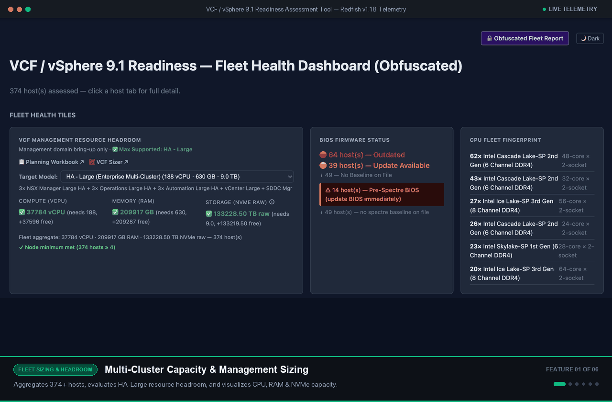
  </a>
  <br>
  <em>Automated enterprise fleet telemetry, memory topology visualizer, ToR fabric mapping, vSAN ESA HCL validation &amp; 84-point BMC security audit.</em>
</p>

---

## 🎬 Video Walkthroughs & Demos

Watch short step-by-step video guides to get up and running, launch on macOS, and interpret generated assessment reports.

> 📺 **[Watch Full YouTube Playlist (3 Videos) →](https://www.youtube.com/playlist?list=PLIyQp4kTfTYU)**

| [Scanner Quick Start (1:19)](https://www.youtube.com/watch?v=nfKTH5aG76s) | [Report Overview (8:20)](https://www.youtube.com/watch?v=tQkxyRHZu4M) | [Launch for Mac from Python (0:55)](https://www.youtube.com/watch?v=L5_IyTcHiMo) |
|:---:|:---:|:---:|
| [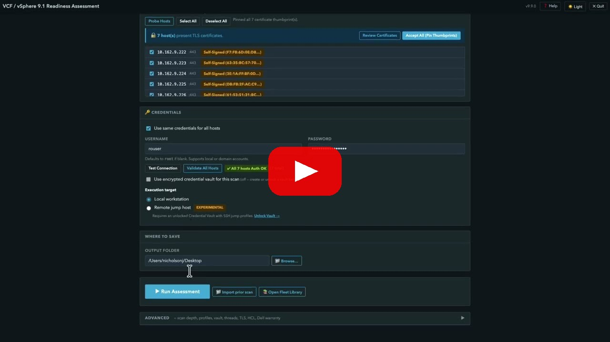](https://www.youtube.com/watch?v=nfKTH5aG76s) | [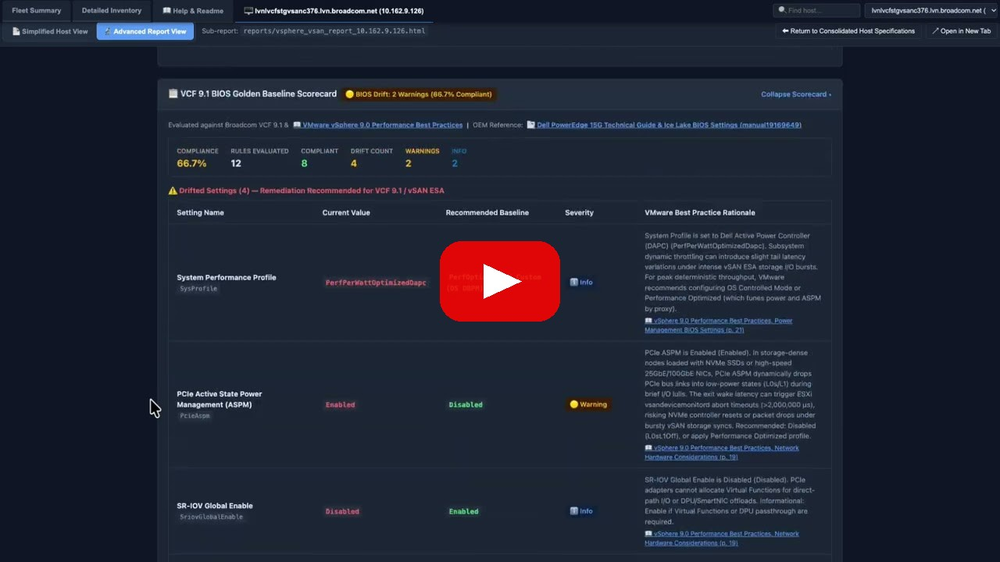](https://www.youtube.com/watch?v=tQkxyRHZu4M) | [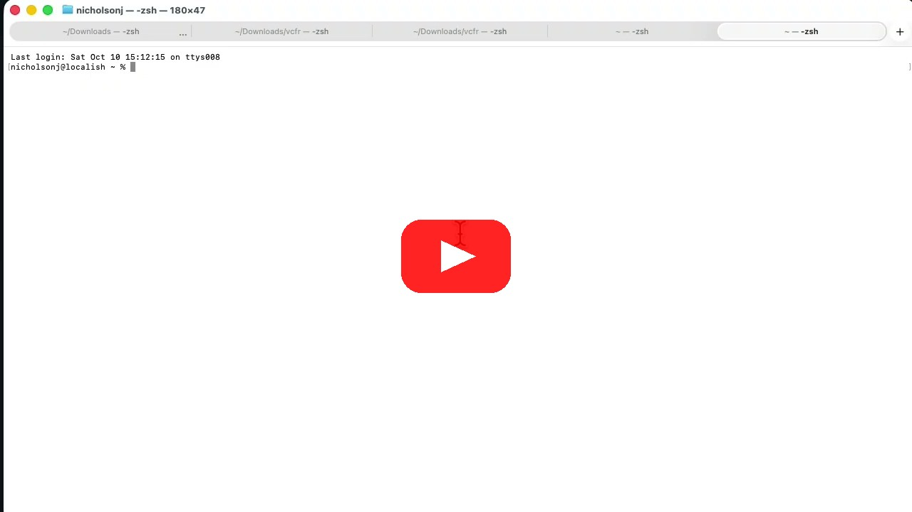](https://www.youtube.com/watch?v=L5_IyTcHiMo) |
| Target entry, credentials, TLS certificates, and initiating a fleet assessment | Detailed walkthrough of fleet summary badges, tabs, BIOS drift, and host sub-reports | Terminal launch with Python standard library on macOS workstations |

---

## Before you start

You need:

- Python 3.9 or newer.
- A current browser for the local web interface.
- Network access from this computer to each BMC management address.
- A BMC account intended for read-only inventory access.
- Permission from the system or network owner to assess the targets.

Check Python:

```bash
python3 --version          # macOS or Linux
python --version           # Windows
```

Run all commands below from the repository root, the directory containing `vcfr_web.py`.

## Glossary

- **BMC**: the out-of-band management controller, such as Dell iDRAC, HPE iLO, Lenovo XCC, Cisco IMC, or a generic Redfish controller.
- **Redfish**: the HTTPS management API used to read hardware inventory.
- **VCF**: VMware Cloud Foundation.
- **vSAN ESA/OSA**: vSAN storage architectures evaluated by the readiness rules.
- **HCL/BCG**: locally cached compatibility data and links to the Broadcom Compatibility Guide.
- **Fleet report**: one summary covering all successfully assessed hosts.

## Run your first verified scan

### 1. Start the local web interface

macOS or Linux:

```bash
python3 vcfr_web.py
```

Windows:

```cmd
python vcfr_web.py
```

The server binds to loopback and opens a one-time launch URL in your browser. If no browser opens, use the URL printed in the terminal. The preferred port is `7182`; the server selects a nearby free port if it is occupied.

### 2. Enter one target

In the browser:

1. Enter one BMC IP address or hostname that you are authorized to assess.
2. Enter the read-only BMC username and password.
3. Leave the scan profile at its default for the first run.
4. Choose an output directory you control.
5. Start the assessment and wait for the completed-host message.

### 3. Verify the result

Open the generated scan directory. A successful scan normally contains:

- `00_fleet_summary.html`: fleet-level dashboard.
- `00_fleet_combined.html`: combined fleet and host view, unless disabled.
- an `.xlsx` workbook, unless disabled.
- `reports/vsphere_vsan_report_<target>.html`: standalone host report.
- `MANIFEST.json` and `Readme.txt`: provenance and output guidance.
- `data/`: structured data when the selected options produce it.

Exact files depend on scan success and options such as `--save-json`, `--csv-export`, `--obfuscate`, `--crawl`, and `--no-combined`.

## Command-line scan

Use an environment variable so the password is not placed in shell history:

```bash
export REDFISH_PASSWORD='replace-me'
python3 vcfr_collector.py \
  --targets 192.0.2.50 \
  --username readonly \
  --password-env REDFISH_PASSWORD \
  --output-dir ./VCF-Scans
```

On Windows Command Prompt:

```cmd
set REDFISH_PASSWORD=replace-me
python vcfr_collector.py --targets 192.0.2.50 --username readonly --password-env REDFISH_PASSWORD --output-dir VCF-Scans
```

Inspect the authoritative option list in your checkout:

```bash
python3 vcfr_collector.py --help
python3 -m vcf_hci.web --help
```

Supported target input is an IP address, hostname, comma-separated list, final-octet range such as `192.0.2.1-20`, or CIDR. Use `--profile readiness-lean` or `--lean` for the supported faster readiness profile.

Previously saved summaries can be rendered without contacting BMCs:

```bash
python3 vcfr_collector.py --from-summary ./VCF-Scans/Scan_example
```

---

## 📊 Visual Report Showcase

Every assessment run generates rich, standalone HTML deliverables (an aggregated **Fleet Summary** and individual **Host Reports**) with zero runtime external asset dependencies.

> 🎥 **Video Tour:** Watch the [**Report Overview Video (8:20) →**](https://www.youtube.com/watch?v=tQkxyRHZu4M) for a guided walkthrough of the fleet summary, status badges, BIOS drift scorecard, and per-host sub-reports.

### 1. Fleet Dashboard & Resource Headroom
Aggregates compute vCPU, RAM, and direct-attached NVMe storage across your entire server inventory, modeling resource headroom against VCF 9.1 management domain sizing profiles.

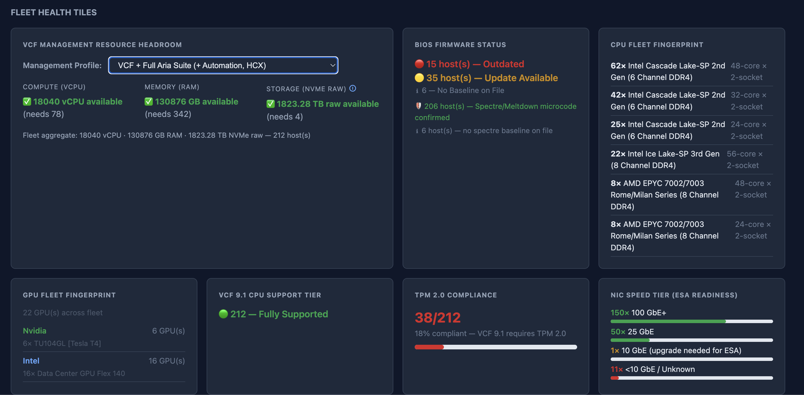

Fleet-wide power redundancy tracking, chassis power cap warnings, vSAN readiness distribution, and aggregate kilowatt telemetry:

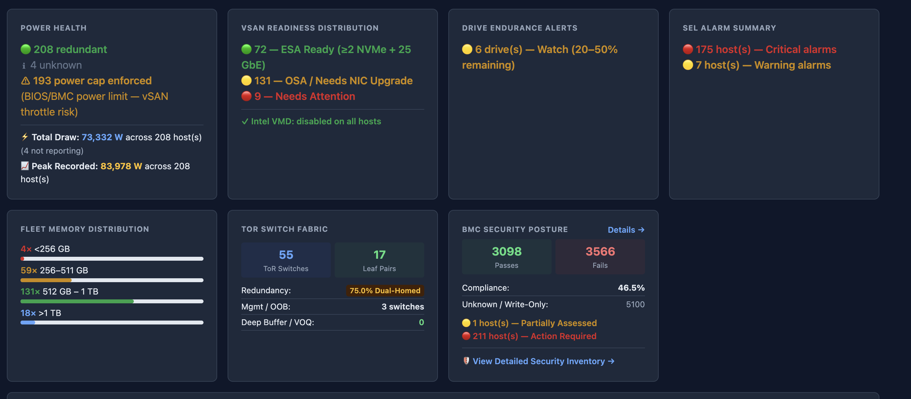

- **Detailed Telemetry:** [Fleet Metric Health Tiles](docs/assets/screenshots/fleet-metric-tiles.png)

---

### 2. Interactive Per-Host Assessment Matrix
Sort, search, and filter servers by OEM vendor, CPU support tier, TPM 2.0 status, and vSAN ESA readiness with direct links into individual host sub-reports.

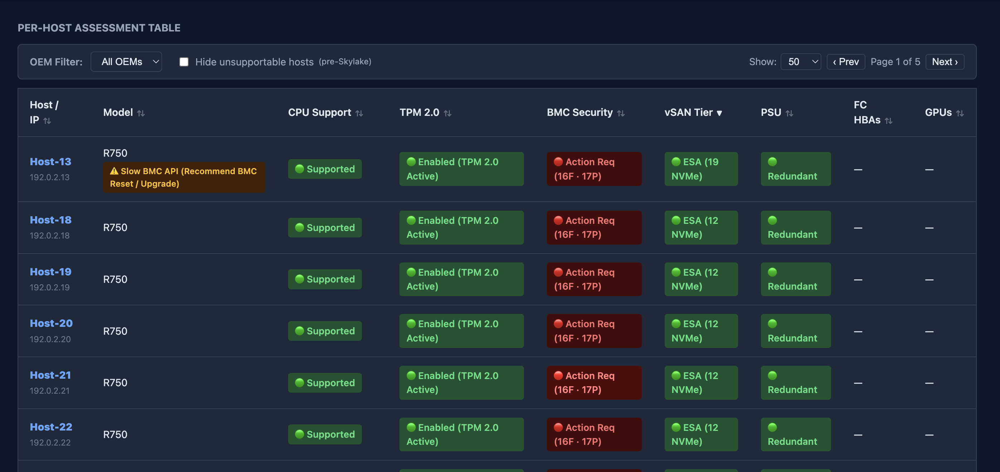

- **Detailed Telemetry:** [Multi-Host Fleet Status Grid](docs/assets/screenshots/fleet-multi-host-capture.png)

---

### 3. Executive Hardware Scorecards & Subsystem Audits
Color-coded executive summary scorecards highlighting CPU compatibility, BIOS currency, TPM 2.0 status, and vSAN driver/firmware alignment against the Broadcom Compatibility Guide (BCG).

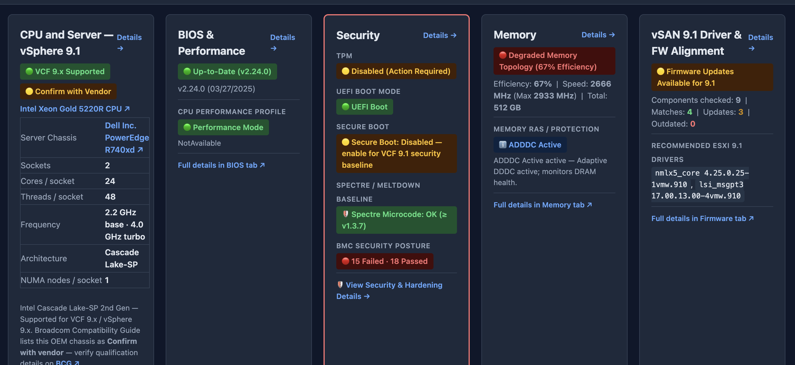

- **Detailed Telemetry:** [Single-Host Assessment Tiles](docs/assets/screenshots/single-host-server-tiles.png) • [Sub-Category Health Breakdown](docs/assets/screenshots/sub-category-system-overview.png)

---

### 4. Physical Motherboard DIMM Slot & Channel Layout
Visualizer mapping installed DIMM modules to physical CPU sockets and memory channels, detecting unbalanced memory interleaving, unpopulated channels, and memory operating below peak rated speeds.

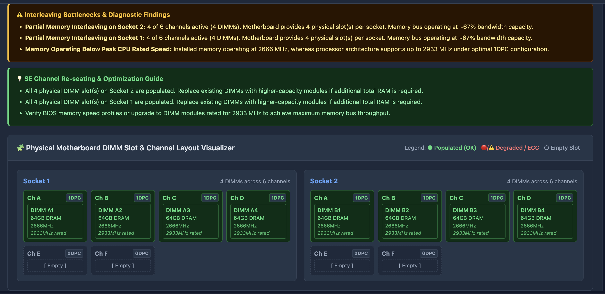

- **Detailed Telemetry:** [Motherboard Channel Topology](docs/assets/screenshots/memory-channel-topology.png)

---

### 5. Storage Subsystem & vSAN ESA Qualification
Evaluates storage controllers, RAID pass-through modes, and NVMe SSDs. Performs exact PCI Quad matching (`VID:DID:SVID:SSID`) against the Broadcom vSAN HCL dataset, calculates SMART drive wear/endurance remaining %, and generates one-click BCG search links.

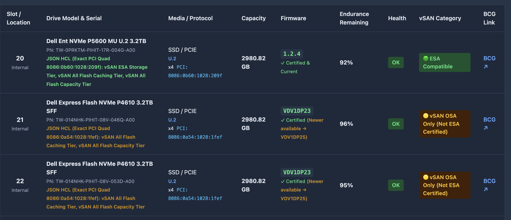

- **Detailed Telemetry:** [vSAN ESA Drive Compliance](docs/assets/screenshots/vsan-esa-drive-compliance.png) • [Drive SMART Telemetry](docs/assets/screenshots/nvme-smart-health-telemetry.png) • [PCIe Lane Inventory](docs/assets/screenshots/pcie-lane-inventory.png)

---

### 6. Network Interfaces & Top-of-Rack (ToR) Switch Fabric
Identifies network adapters and port speeds (verifying ≥25 GbE ESA requirements), queries LLDP and Cisco CDP neighbor data to discover connected Top-of-Rack switches, and correlates leaf switch pairs to highlight single-homed hosts and cabling miswires.

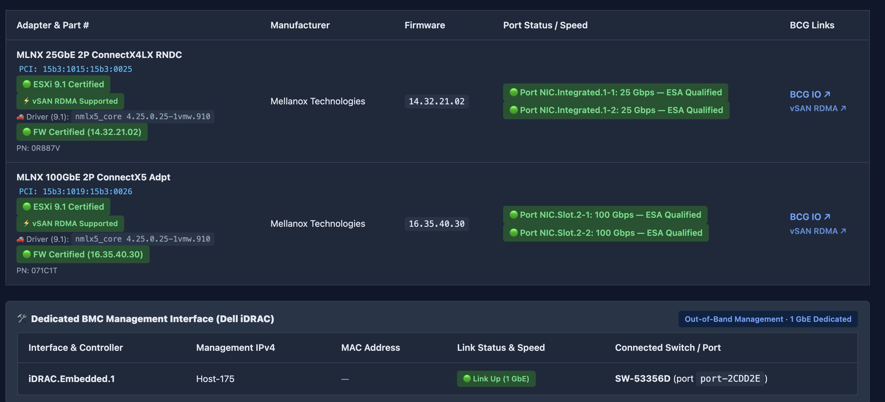

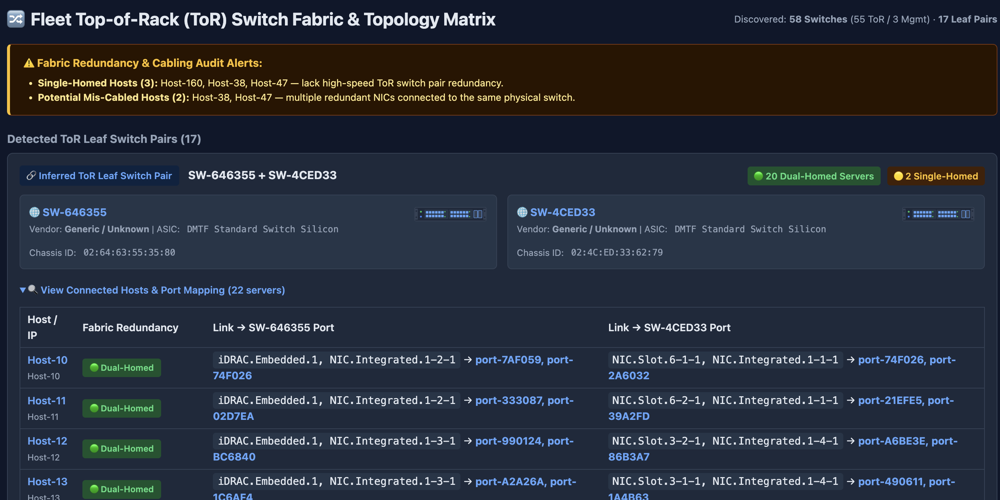

- **Detailed Telemetry:** [NIC Optics & LLDP Detection](docs/assets/screenshots/nic-optics-lldp-detection.png) • [LLDP / CDP Switch Neighbors](docs/assets/screenshots/lldp-cdp-switch-neighbors.png)

---

### 7. System Event Log (SEL / IML) & Diagnostic Decoders
Extracts the latest Warning and Critical hardware alarms from the server's event log, integrating direct links to Dell EEMS diagnostic guides and HPE IML documentation.

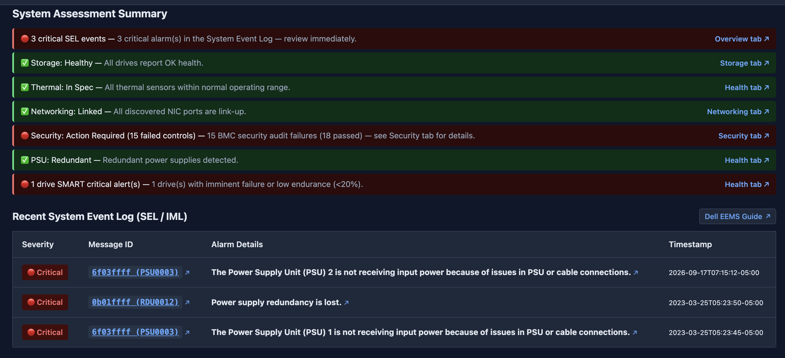

- **Detailed Telemetry:** [System Event Log Monitoring](docs/assets/screenshots/system-event-log-monitoring.png)

---

### 8. 84-Control BMC Hardware Security Audit & Golden BIOS Baseline
Out-of-band security compliance audit evaluating 84 canonical controls aligned with the **CISA & NSA Joint BMC Hardening Guide**, **VMware Cloud Foundation Security Configuration Guide (SCG 9.1)**, and **NIST SP 800-193**. Evaluates BIOS performance drift against Broadcom VCF 9.1 Golden Baselines.

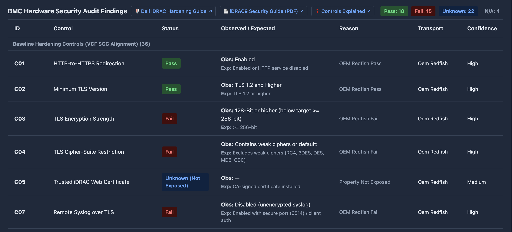

- **Detailed Telemetry:** [BMC Hardware Security Audit](docs/assets/screenshots/bmc-hardware-security-audit.png) • [Hardware Security Baseline](docs/assets/screenshots/hardware-security-baseline.png) • [BIOS Golden Baseline Drift](docs/assets/screenshots/bios-golden-baseline-drift.png) • [BIOS Performance Settings](docs/assets/screenshots/bios-performance-settings.png)

> 📖 **Comprehensive Reference Guide:** For an exhaustive tab-by-tab and field-by-field reference explaining every metric, evaluation rule, official VMware KB, and the 84-control BMC security audit, see the [**User Guide & Reference Manual (docs/USER_GUIDE_REFERENCE.md)**](docs/USER_GUIDE_REFERENCE.md).

---

## 🔍 Multi-Vendor BMC Platform Support

| BMC Platform | Architecture & Adapters | Assessment Depth |
|:-------------|:------------------------|:-----------------|
| **Dell iDRAC** | `DellCollector` (iDRAC7/8/9/10) | Full OEM telemetry (SKU, BIOS date, NVMe SMART wear, EEMS alerts, license) |
| **HPE iLO** | `HPECollector` (iLO 4/5/6) | Full OEM hooks (SmartStorage, system usage, IML event logs, license) |
| **Supermicro BMC** | `SupermicroCollector` | SimpleStorage, drive inventory, DCMS license detection |
| **Cisco IMC** | `CiscoCollector` (CIMC) | `/Managers/CIMC`, physical drive metrics, Cisco CDP neighbor discovery |
| **Lenovo XCC** | `LenovoCollector` (XCC/XCC2) | Drive metrics, LicenseService tiers, ThinkSystem inventory |
| **Quanta / QCT** | `QuantaCollector` | Dynamic root discovery, RackScale drive OEM inventory |
| **GIGABYTE BMC** | `GigabyteCollector` | Self-roots, `Oem.GBT` slot detection, SimpleStorage |
| **Generic Redfish** | `GenericCollector` | Universal DMTF Redfish fallback for standard platforms |

---

## Security and network behavior

### Strict read-only collection

The collector blocks BMC configuration changes. It permits read methods, Redfish session creation and teardown, and protocol-required read-semantic POSTs used by WS-Man and Cisco XML inventory. It does not invoke power, reset, firmware, account, BIOS, boot, or configuration actions.

A read-only BMC account is still required. A vendor may restrict some inventory endpoints, so missing fields can reflect account permissions or firmware behavior.

### Offline by default

An ordinary scan contacts the targets you provide and writes reports locally. It does not send analytics, telemetry, crash reports, or scan results to the project.

Public-network egress is explicit:

- `--refresh-hcl`, `--bundle-hcl`, or the equivalent web action downloads public Broadcom HCL data.
- Dell TechDirect warranty enrichment contacts Dell only after credentials are supplied and the feature is enabled.
- External credential providers contact their configured service only when explicitly configured.
- Experimental jump-host execution uses SSH only when selected in the local web UI.

The CLI and web UI otherwise use existing local HCL data and packaged baselines. See [Security Architecture](docs/SECURITY_ARCHITECTURE.md) for the protocol details.

### TLS

BMC certificate verification is disabled by default to support self-signed management controllers. Prefer `--verify-ssl` and `--ca-bundle` when your environment has a trusted BMC CA. `--legacy-tls` deliberately weakens protocol compatibility and should be used only for an approved legacy controller.

The browser UI is local-only by default. For a headless host, keep it on loopback and use SSH port forwarding; see [Installation](docs/INSTALL.md).

## What the assessment covers

Depending on what a BMC exposes, reports can include:

- CPU generation and VCF support classification.
- Memory inventory and topology observations.
- Storage controllers, physical drives, NVMe health, and vSAN readiness.
- Network adapters, link speeds, firmware data, and LLDP/CDP neighbors.
- BIOS, BMC firmware, TPM, boot, power, thermal, GPU, and event-log inventory.
- Read-only BMC security findings.
- Fleet HTML, host HTML, Excel, CSV, JSON, and obfuscated outputs.

Collectors include generic DMTF Redfish plus OEM handling for vendors represented in `vcf_hci/collector/oem/`. Support depth varies by model, BMC generation, firmware, license, and exposed schema.

## Limitations

- This is an assessment aid, not a substitute for current Broadcom product documentation, support policy, or a final design review.
- A green result does not certify a server or guarantee upgrade success.
- Compatibility data can become stale. The default-offline behavior does not refresh it automatically.
- Self-signed TLS is accepted unless verification is enabled.
- Some BMCs omit fields, rate-limit requests, require extra licenses, or return partial inventory.
- The tool does not configure hardware, remediate findings, install software, or change firmware.
- Remote jump-host execution is experimental and available through the local web UI; there is no standalone remote-scan CLI.
- This repository does not promise prebuilt binaries or release assets. Run from source unless a separately verified distribution is supplied by your organization.

## Troubleshooting

### `python` or `python3` is not found

Install Python 3.9 or newer from [python.org](https://www.python.org/downloads/) or your operating system's approved package source, then open a new terminal.

### `ModuleNotFoundError: No module named 'vcf_hci'`

Change to the repository root before launching:

```bash
cd /path/to/vcf-readiness
python3 vcfr_web.py
```

### The browser does not open

Copy the one-time URL printed by `vcfr_web.py`. For a headless machine, follow the SSH forwarding steps in [docs/INSTALL.md](docs/INSTALL.md).

### Authentication fails

Confirm the BMC address, username, password, account lockout state, and read privileges. Do not paste credentials into an issue or log.

### The BMC is unreachable or the scan is partial

Check the management VLAN or VPN route and HTTPS reachability. Reduce `--threads`, increase `--host-timeout`, or try `--allow-partial` for slow controllers. Review the generated failed-host CSV and debug log before sharing them; they may contain sensitive infrastructure data.

### Certificate validation fails

Use the correct enterprise CA with `--ca-bundle`, confirm the target hostname matches the certificate, and enable DNS lookup only if your environment permits it. Do not work around a production trust failure without approval.

### No HCL match appears

The local dataset may be absent or stale. Import an approved offline bundle with `--import-hcl`, or explicitly refresh from an internet-connected environment with `--refresh-hcl`.

## More documentation

- [Installation and headless use](docs/INSTALL.md)
- [Architecture](ARCHITECTURE.md)
- [Security architecture](docs/SECURITY_ARCHITECTURE.md)
- [Credential vault](docs/CREDENTIAL_VAULT.md)
- [User Guide & Reference](docs/USER_GUIDE_REFERENCE.md)
- [Customer Infographic](docs/INFOGRAPHIC.md)
- [Contributing](CONTRIBUTING.md)
- [License](LICENSE.md)

---

## 🔗 References & Credits

### Broadcom & VMware References
- **[KB 428874](https://knowledge.broadcom.com/external/article/428874)** — vSphere/VCF 9.x CPU Deprecated Mode Support Policy
- **[Broadcom Compatibility Guide](https://compatibilityguide.broadcom.com/)** — Live hardware search matrix
- **[vSAN HCL JSON](https://vvs.broadcom.com/service/vsan/all.json)** — Live vSAN drive certification dataset

### Switch Buffer & Silicon Research
- **[Michael Buraglio's Packet Buffer Reference](https://port-buffers.forwardingplane.net/)** ([GitHub: buraglio/port-buffers](https://github.com/buraglio/port-buffers))
- **[Jim Warner's UCSC Packet Buffer Research](https://people.ucsc.edu/~warner/buffer-wuz.html)** ([ASIC Buffer History](https://people.ucsc.edu/~warner/Bufs/buf-hist.html))

### Project Acknowledgements
- **Phong Le** — For answering 40,000 hardware HCL questions.
- **Onur Yuzseven & Brock Peterson** — For the vCommunity plugins and VMware Aria/VCF Operations guidance.
- **Spiceworks Community** — For community hardware discussions and insights on server repurposing.
- Built with [Clarity Design System](https://clarity.design/) design tokens (VMware/Broadcom, Apache-2.0 license).

---

## License

CA, Inc. License — see [LICENSE.md](LICENSE.md) and [NOTICE](NOTICE). For third-party components included in standalone distributions, see [THIRD_PARTY_LICENSES.md](THIRD_PARTY_LICENSES.md).