# VCF Readiness Assessment Tool

Experimental VDT integration: see **Help → VDT** in the scanner for installation, native JSON import, hybrid reports, and current limitations.


> Zero-dependency Python tool for VMware Sales Engineers, Solution Architects, and IT teams to assess server hardware for VMware Cloud Foundation 9.1 and vSAN Express Storage Architecture (ESA) repurposing.

- [Python 3.9+](https://python.org)
- Zero dependencies
- [Download v9.14.0b1](https://github.com/vmware/vcf-readiness/releases/tag/9.14.0-beta.1)
- [Presentation kit](docs/INFOGRAPHIC.md)

---

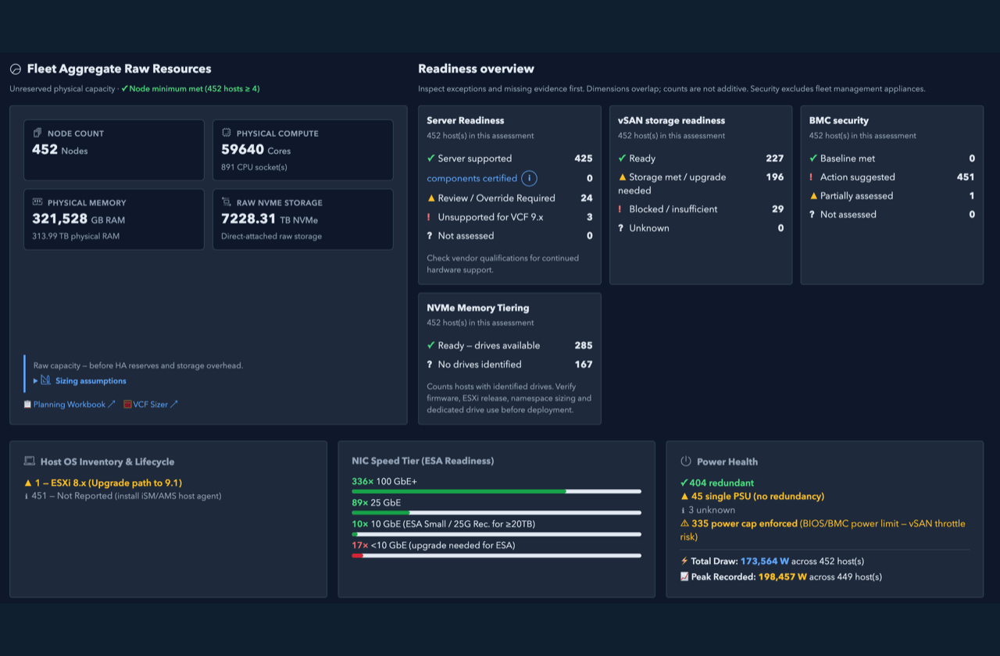

*Automated enterprise fleet telemetry, memory topology visualizer, ToR fabric mapping, vSAN ESA HCL validation & 84-point BMC security audit.*

[Visual report showcase](#-visual-report-showcase)

---

## 🎬 Video Walkthroughs & Demos

Watch short step-by-step video guides to get up and running, launch on macOS, and interpret generated assessment reports.

> 📺 **[Watch Full YouTube Playlist (3 Videos) →](https://www.youtube.com/playlist?list=PLIyQp4kTfTYU)**

| [Scanner Quick Start (1:19)](https://www.youtube.com/watch?v=nfKTH5aG76s) | [Report Overview (8:20)](https://www.youtube.com/watch?v=tQkxyRHZu4M) | [Launch for Mac from Python (0:55)](https://www.youtube.com/watch?v=L5_IyTcHiMo) |
|:---:|:---:|:---:|
| [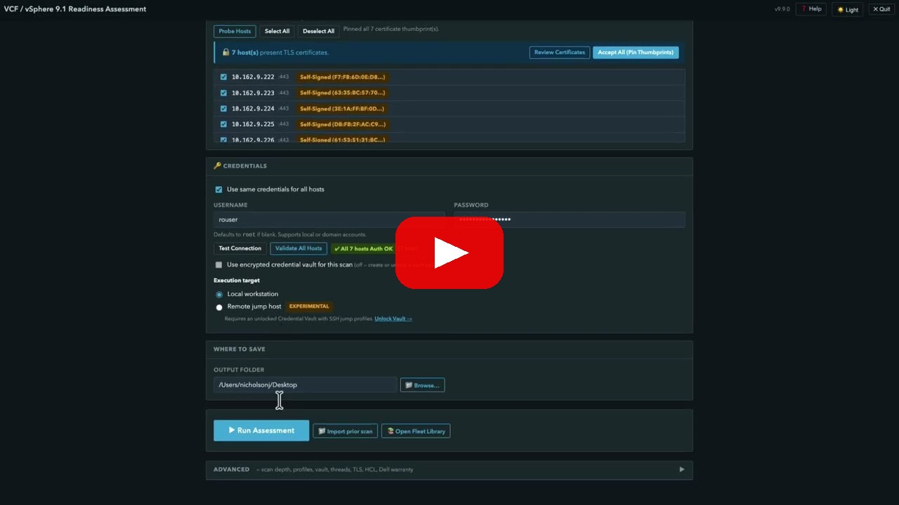](https://www.youtube.com/watch?v=nfKTH5aG76s) | [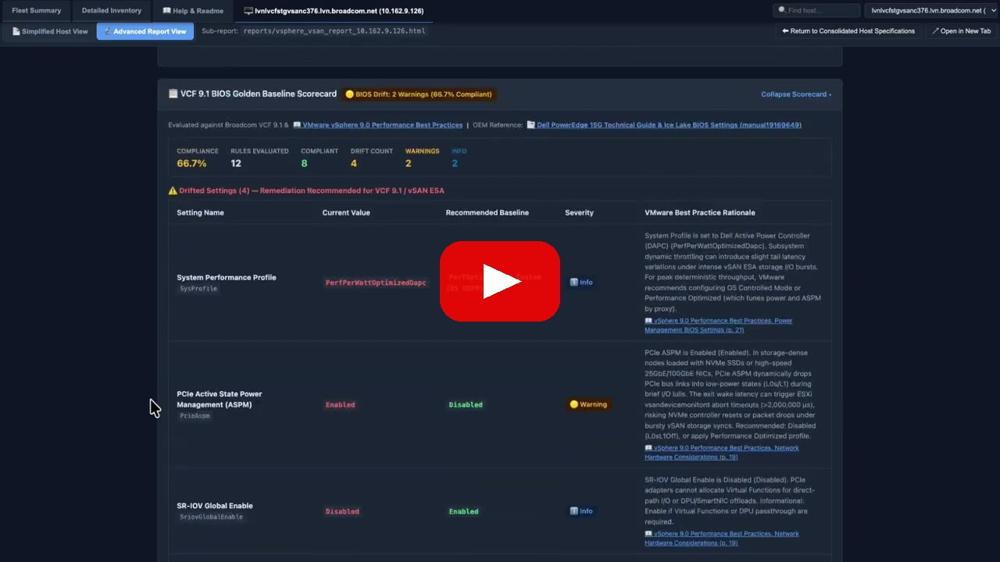](https://www.youtube.com/watch?v=tQkxyRHZu4M) | [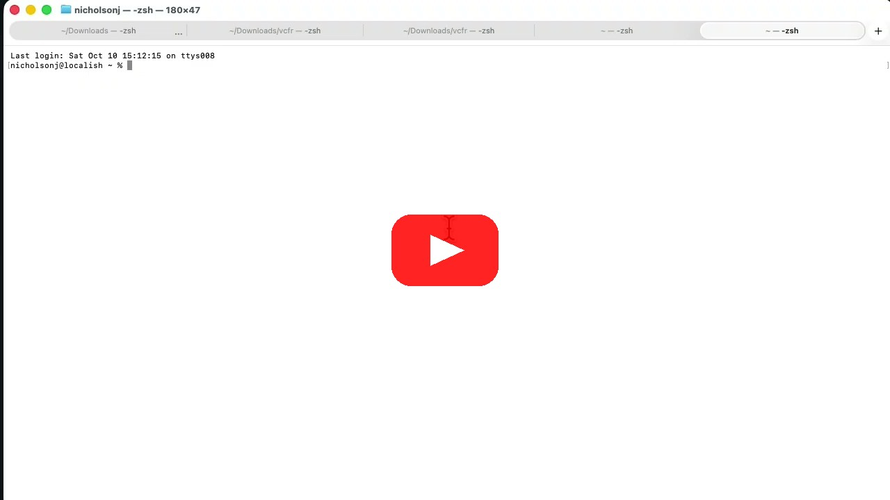](https://www.youtube.com/watch?v=L5_IyTcHiMo) |
| Target entry, credentials, TLS certificates, and initiating a fleet assessment | Detailed walkthrough of fleet summary badges, tabs, BIOS drift, and host sub-reports | Terminal launch with Python standard library on macOS workstations |

---

## 💾 Download & Installation

The recommended and verified installation runs directly from source using the Python 3.9+ standard library (zero external dependencies).

[Download the complete source bundle (v9.14.0b1 ZIP)](https://github.com/vmware/vcf-readiness/releases/download/9.14.0-beta.1/Distribution-VCF-Readiness.zip)

*Includes complete source code, web UI, CLI scanner, and offline HCL database. No `pip install` required.*

<details>
<summary><strong>Alternative: Pre-compiled standalone binaries (unsigned developer builds)</strong></summary>

If Python is not available on your system, standalone executables are provided on the [GitHub Release 9.14.0-beta.1 page](https://github.com/vmware/vcf-readiness/releases/tag/9.14.0-beta.1):

- **Windows:** `VCF-Readiness-Web-v9.14.0b1-win.zip` (extract and double-click the executable; may show Windows SmartScreen notice). The archive includes `Launch-VCF-Readiness-Web.bat` as a shortcut to the executable.
- **macOS:** `VCF-Readiness-Web-v9.14.0b1-mac.zip` (contains launcher script; may require Gatekeeper right-click Open override).

*Note: These are unsigned community convenience builds. To avoid operating system security prompts, running directly from source with Python 3.9+ is strongly recommended.*

For other release options, view [all release tags](https://github.com/vmware/vcf-readiness/releases).
</details>

---

## Before you start

You need:

- Python 3.9 or newer.
- A current browser for the local web interface.
- Network access from this computer to each BMC management address.
- A BMC account intended for read-only inventory access.
- Permission from the system or network owner to assess the targets.

Check Python:

```bash
python3 --version          # macOS or Linux
python --version           # Windows
```

Run all commands below from the repository root, the directory containing `vcfr_web.py`.

## Glossary

- **BMC**: the out-of-band management controller, such as Dell iDRAC, HPE iLO, Lenovo XCC, Cisco IMC, or a generic Redfish controller.
- **Redfish**: the HTTPS management API used to read hardware inventory.
- **VCF**: VMware Cloud Foundation.
- **vSAN ESA/OSA**: vSAN storage architectures evaluated by the readiness rules.
- **HCL/BCG**: locally cached compatibility data and links to the Broadcom Compatibility Guide.
- **Fleet report**: one summary covering all successfully assessed hosts.

## Run your first verified scan

### 1. Start the local web interface

macOS or Linux:

```bash
python3 vcfr_web.py
```

Windows:

```cmd
python vcfr_web.py
```

Source bundles built with the Windows launcher also support double-clicking `Launch-VCF-Readiness-Web.bat` after extracting the complete ZIP. It finds Python 3.9 or newer using `python`, `py -3`, or `python3`. The standalone Windows ZIP launcher runs its bundled executable and does not require Python.

Launching through `python3` or `python` needs no executable permission and no `chmod`. See [installation guidance](docs/INSTALL.md#start-the-web-ui) for direct execution on macOS/Linux.

The server binds to loopback and opens a one-time launch URL in your browser. If no browser opens, use the URL printed in the terminal. The preferred port is `7182`; the server selects a nearby free port if it is occupied.

At launch, the browser scanner checks the public GitHub release metadata in the background. A small **Update available** link appears beside the version only when a newer stable release exists. It opens the release page; nothing is downloaded or installed automatically. Offline and rate-limit failures stay quiet. Set `VCF_READINESS_CHECK_UPDATES=0` before launch to disable the check; see [offline operation](docs/INSTALL.md#offline-and-air-gapped-operation).

### 2. Enter one target

In the browser:

1. Enter one BMC IP address or hostname that you are authorized to assess.
2. Enter the read-only BMC username and password.
3. Leave the scan profile at its default for the first run.
4. Choose an output directory you control.
5. Start the assessment and wait for the completed-host message.

### 3. Verify the result

Open the generated scan directory. A successful scan normally contains:

- `00_fleet_summary.html`: fleet-level dashboard.
- `00_fleet_combined.html`: combined fleet and host view, unless disabled.
- an `.xlsx` workbook, unless disabled.
- `reports/vsphere_vsan_report_<target>.html`: standalone host report.
- `MANIFEST.json` and `Readme.txt`: provenance and output guidance.
- `data/`: structured data when the selected options produce it.

Exact files depend on scan success and options such as `--save-json`, `--csv-export`, `--obfuscate`, `--crawl`, and `--no-combined`.

## Browser navigation and Scan Wizard

Use **Scanner** for direct scan setup, **Scan Library** to import prior scans or assemble a fleet from a folder, and **Credential Vault** to manage saved BMC credentials and jump hosts. **Advanced Configuration** contains saved profiles, scan depth, TLS, HCL, export, and warranty settings.

**Scan Wizard** walks through targets, credentials and execution, HCL readiness, scan options and output, and review before running. It shares settings with Scanner. New scans use manual credentials and local execution by default; vault credentials and remote jump-host execution are explicit choices.

The HCL step checks local data and offers **Refresh Live HCL** or **Import Dark-Site HCL Zip**. Web UI launch also refreshes vSAN and Memory Tiering BCG data in the background; use `--no-hcl-auto-refresh` or preload `--import-hcl` for offline HCL startup. Dark-site ZIPs include the Memory Tiering dataset. If download fails, expand **Cannot download? Generate a dark-site HCL ZIP** in that step. Missing, outdated, baseline, or unverified HCL data requires acknowledgment before continuing; it does not establish hardware certification. See the [offline installation guide](docs/INSTALL.md#offline-and-air-gapped-operation).

Use **+ Server groups** to tag selected targets without requiring a probe, then filter or bulk-manage memberships in Scan Library. Scanner and report density/theme controls persist independently of assessment data. Reviewed UI symbols use always-on, offline Clarity SVG icons. See [Server Groups and Display](docs/SCANNER_GROUPS_AND_DISPLAY.md).

## Executive summary and report presentation

After a scan, import, or fleet assembly, choose **Executive summary (PDF)** for a condensed environment brief with CPU support, vSAN ESA readiness, BMC security coverage, and up to ten prioritized action groups. **View executive summary** opens the printable HTML version; **Executive PDF — obfuscated** masks host identifiers for sharing. Fleet summary generation also writes `00_executive_summary.pdf` and `.html` beside the detailed reports.

Scanner and HTML reports use Clarity SVG icons by default, including hardware and evidence-based drive-media symbols. Legacy emoji display controls have been retired; old saved preferences cannot disable icons. Collected values, group names, copied paths and CSV/Excel data retain their original text. The executive PDF keeps its text-oriented layout.

The visual design uses neutral surfaces and label text, reserving status color for small accents. The executive brief is an assessment snapshot, not a hardware certification decision. [Executive report details and ranking](docs/EXECUTIVE_REPORT.md).

## Command-line scan

Use an environment variable so the password is not placed in shell history:

```bash
export REDFISH_PASSWORD='replace-me'
python3 vcfr_collector.py \
  --targets 192.0.2.50 \
  --username readonly \
  --password-env REDFISH_PASSWORD \
  --output-dir ./VCF-Scans
```

On Windows Command Prompt:

```cmd
set REDFISH_PASSWORD=replace-me
python vcfr_collector.py --targets 192.0.2.50 --username readonly --password-env REDFISH_PASSWORD --output-dir VCF-Scans
```

Inspect the authoritative option list in your checkout:

```bash
python3 vcfr_collector.py --help
python3 -m vcf_hci.web --help
```

Supported target input is an IP address, hostname, comma-separated list, final-octet range such as `192.0.2.1-20`, or CIDR. Use `--profile readiness-lean` or `--lean` for the supported faster readiness profile.

Previously saved summaries can be rendered without contacting BMCs:

```bash
python3 vcfr_collector.py --from-summary ./VCF-Scans/Scan_example
```

---

## 📊 Visual Report Showcase

Current report and workflow screenshots. Click any image to view it at full resolution. Screenshots may show beta UI; feature availability depends on your release.

### Fleet capacity and readiness

[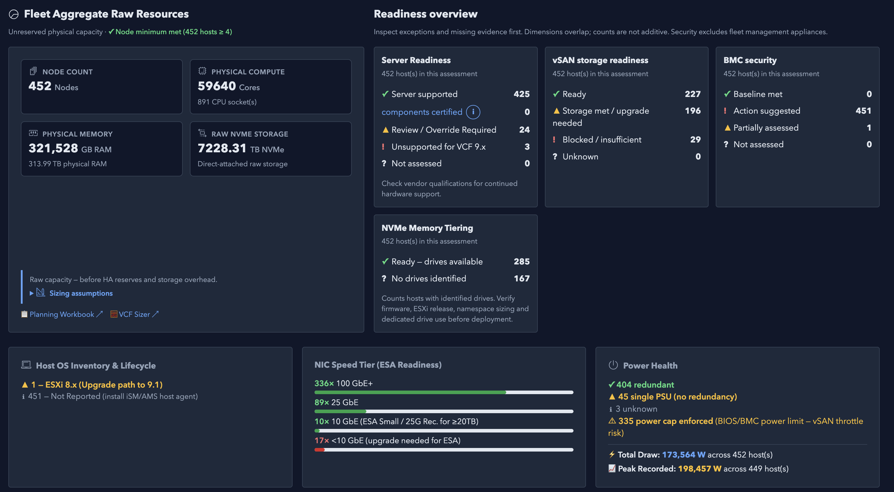](docs/assets/screenshots/fleetview.png)

### Fleet security, power and health

[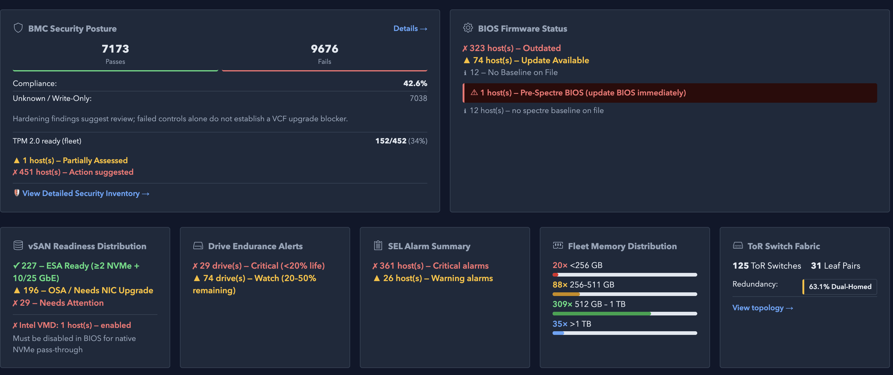](docs/assets/screenshots/fleet-tiles.png)

### Host readiness scorecards

[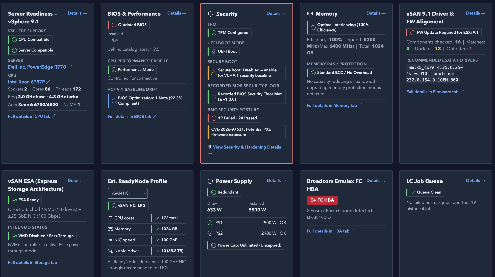](docs/assets/screenshots/host-tiles.png)

### CPU detection and architecture

[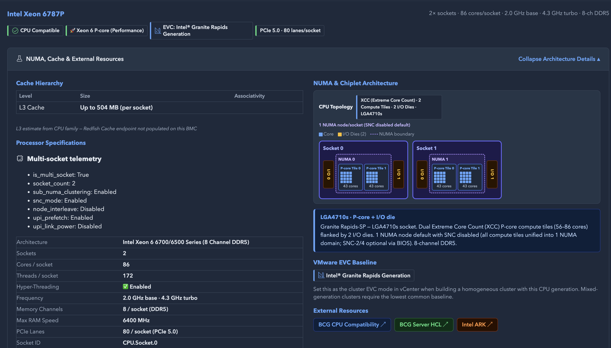](docs/assets/screenshots/cpu-detection.png)

### Memory performance review

[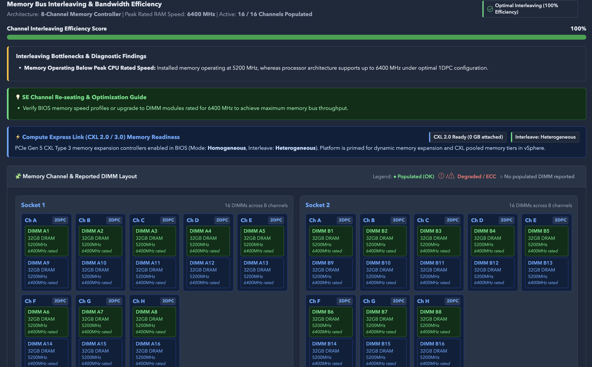](docs/assets/screenshots/memory-performance-review.png)

### DIMM channels and topology

[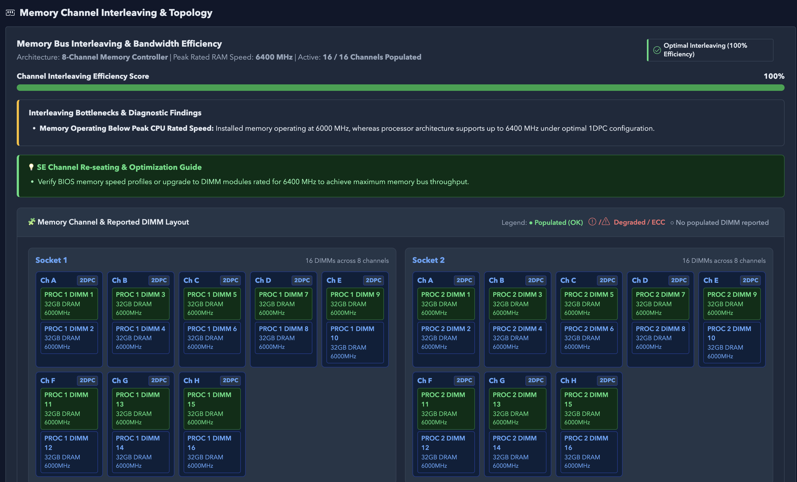](docs/assets/screenshots/memory-channel-topology.png)

### Storage compatibility and firmware

[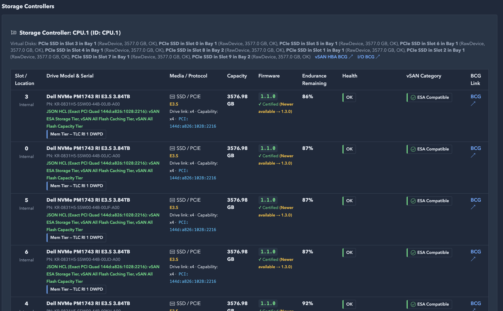](docs/assets/screenshots/vsan-drive-hcl-check.png)

### NVMe SMART health

[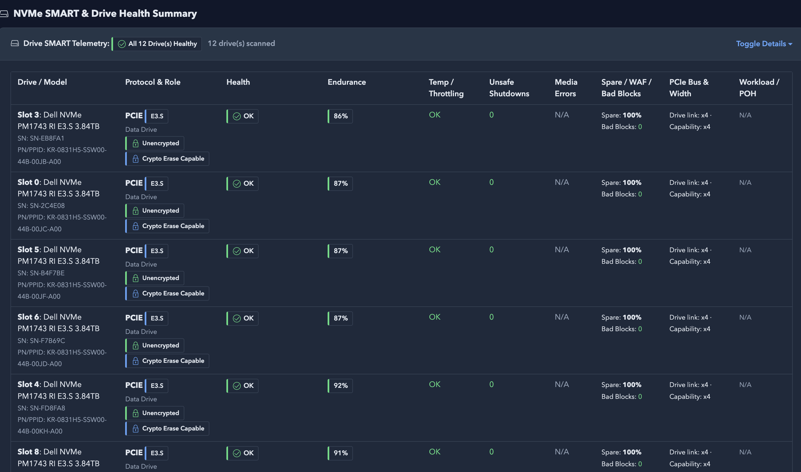](docs/assets/screenshots/nvme-drive-smart-checks.png)

### Network fabric discovery

[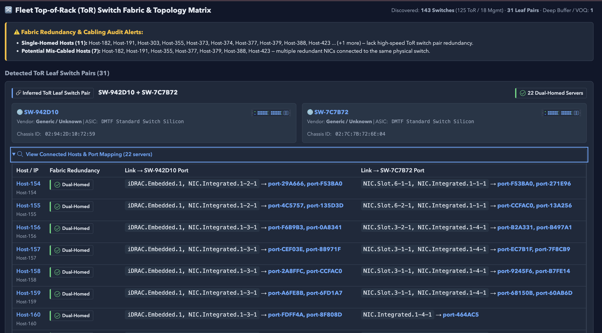](docs/assets/screenshots/network-switch-detection.png)

### Fibre Channel discovery

[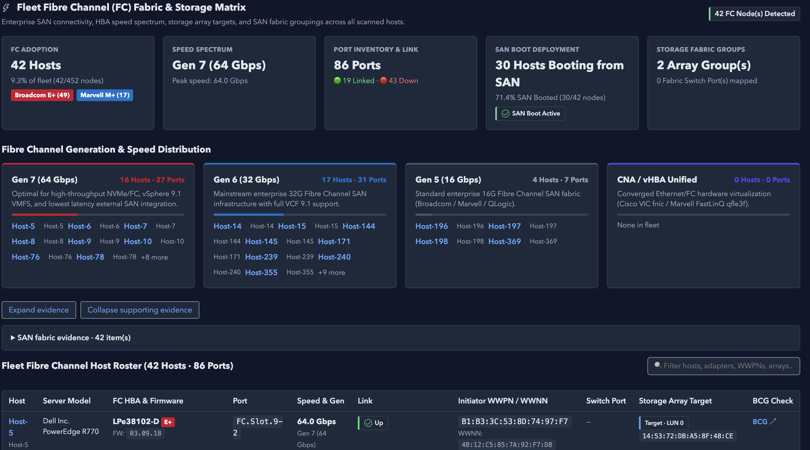](docs/assets/screenshots/fibrechannel-discovery.png)

### BIOS performance guidance

[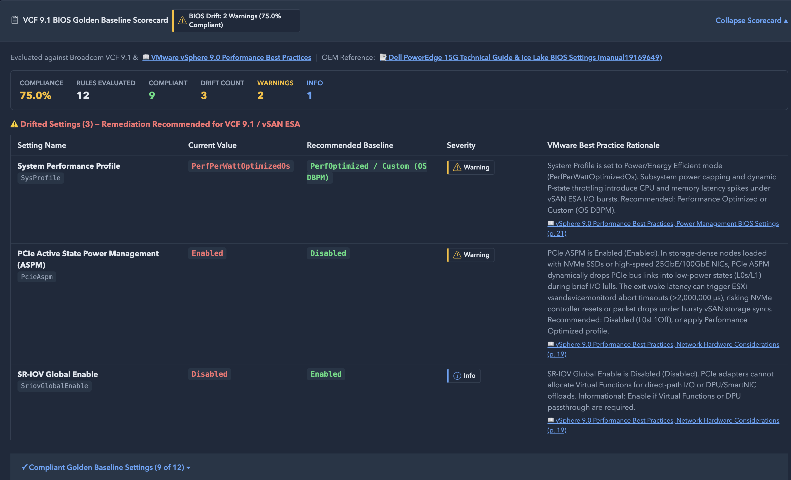](docs/assets/screenshots/performance-guide-audit.png)

### BMC hardening audit

[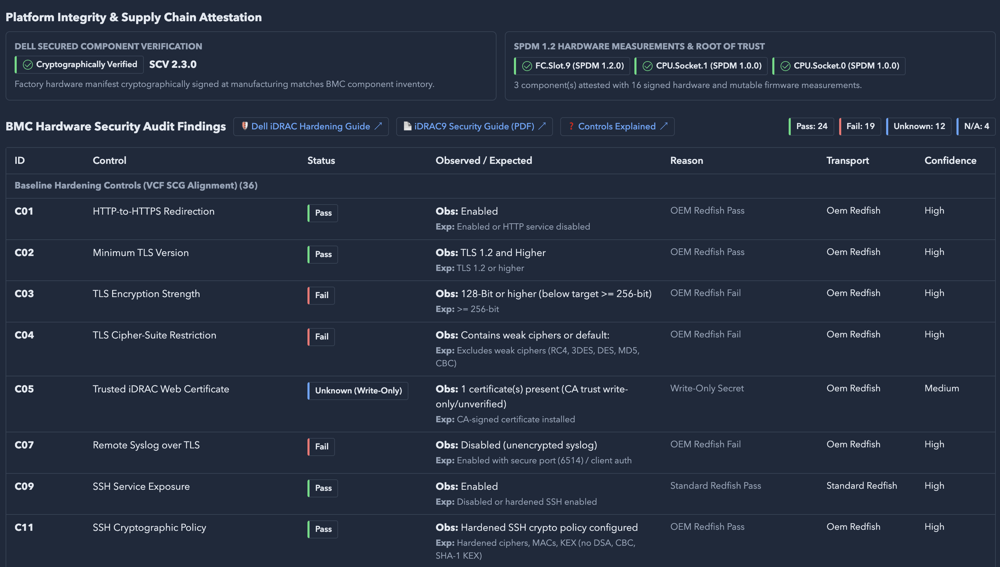](docs/assets/screenshots/hardening-audit-security.png)

### Security diagnostics

[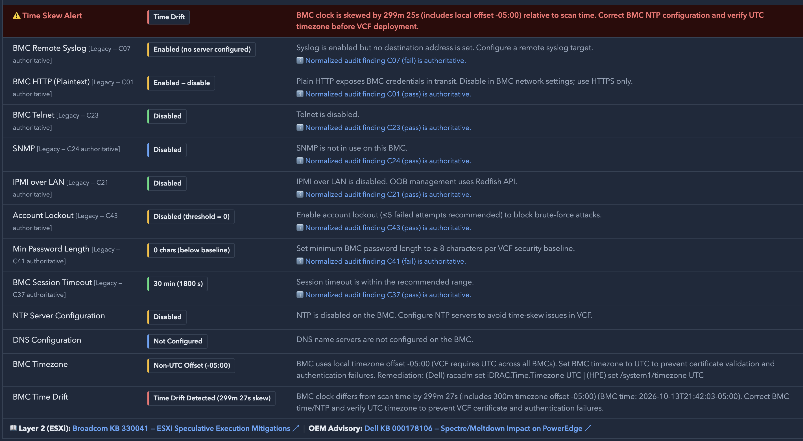](docs/assets/screenshots/security-review.png)

### HCL updates and dark-site support

[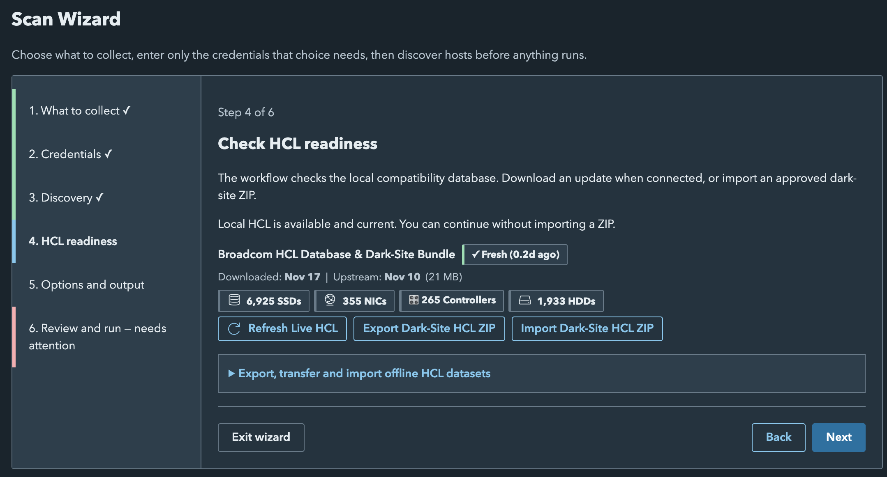](docs/assets/screenshots/hcl-update-updating-darksite-support.png)

---

## 🔍 Multi-Vendor BMC Platform Support

| BMC Platform | Architecture & Adapters | Assessment Depth |
|:-------------|:------------------------|:-----------------|
| **Dell iDRAC** | `DellCollector` (iDRAC7/8/9/10) | Full OEM telemetry (SKU, BIOS date, NVMe SMART wear, EEMS alerts, license) |
| **HPE iLO** | `HPECollector` (iLO 4/5/6) | Full OEM hooks (SmartStorage, system usage, IML event logs, license) |
| **Supermicro BMC** | `SupermicroCollector` | SimpleStorage, drive inventory, DCMS license detection |
| **Cisco IMC** | `CiscoCollector` (CIMC) | `/Managers/CIMC`, physical drive metrics, Cisco CDP neighbor discovery |
| **Lenovo XCC** | `LenovoCollector` (XCC/XCC2) | Drive metrics, LicenseService tiers, ThinkSystem inventory |
| **Quanta / QCT** | `QuantaCollector` | Dynamic root discovery, RackScale drive OEM inventory |
| **GIGABYTE BMC** | `GigabyteCollector` | Self-roots, `Oem.GBT` slot detection, SimpleStorage |
| **Generic Redfish** | `GenericCollector` | Universal DMTF Redfish fallback for standard platforms |

---

## Security and network behavior

### Strict read-only collection

The collector blocks BMC configuration changes. It permits read methods, Redfish session creation and teardown, and protocol-required read-semantic POSTs used by WS-Man and Cisco XML inventory. It does not invoke power, reset, firmware, account, BIOS, boot, or configuration actions.

A read-only BMC account is still required. A vendor may restrict some inventory endpoints, so missing fields can reflect account permissions or firmware behavior.

### Offline by default

An ordinary scan contacts the targets you provide and writes reports locally. It does not send analytics, telemetry, crash reports, or scan results to the project.

The Web UI refreshes public vSAN and Memory Tiering data at launch unless `--no-hcl-auto-refresh` or `--import-hcl` is used. CLI scans and library loads stay offline and use existing local HCL data and packaged baselines.

`--refresh-hcl`, `--bundle-hcl`, and the equivalent web action remain explicit downloads of public Broadcom HCL data. Warranty enrichment and external credential providers stay explicit:

- Dell TechDirect warranty enrichment contacts Dell only after credentials are supplied and the feature is enabled.
- External credential providers contact their configured service only when explicitly configured.
- Experimental jump-host execution uses SSH only when selected in the local web UI.

The browser server also checks GitHub release metadata once per launch by default. Set `VCF_READINESS_CHECK_UPDATES=0` before launch to disable it. The CLI does not start this check. See [Security Architecture](docs/SECURITY_ARCHITECTURE.md) for the protocol details.

### TLS

BMC certificate verification is disabled by default to support self-signed management controllers. Prefer `--verify-ssl` and `--ca-bundle` when your environment has a trusted BMC CA. `--legacy-tls` deliberately weakens protocol compatibility and should be used only for an approved legacy controller.

The browser UI is local-only by default. For a headless host, keep it on loopback and use SSH port forwarding; see [Installation](docs/INSTALL.md).

## What the assessment covers

Depending on what a BMC exposes, reports can include:

- CPU generation and VCF support classification.
- Memory inventory and topology observations.
- Storage controllers, physical drives, NVMe health, and vSAN readiness.
- Memory Tiering drive evidence: catalog badges and fleet/host availability counts, not firmware or deployment validation. See [Memory Tiering](docs/MEMORY_TIERING.md).
- Network adapters, link speeds, firmware data, and LLDP/CDP neighbors.
- BIOS, BMC firmware, TPM, boot, power, thermal, GPU, and event-log inventory.
- Read-only BMC security findings.
- Fleet HTML, host HTML, Excel, CSV, JSON, and obfuscated outputs.

Collectors include generic DMTF Redfish plus OEM handling for vendors represented in `vcf_hci/collector/oem/`. Support depth varies by model, BMC generation, firmware, license, and exposed schema.

## Limitations

- This is an assessment aid, not a substitute for current Broadcom product documentation, support policy, or a final design review.
- A green result does not certify a server or guarantee upgrade success.
- Compatibility data can become stale. Web UI launch refreshes public vSAN and Memory Tiering data unless disabled with `--no-hcl-auto-refresh` or an offline bundle is preloaded with `--import-hcl`. A failed refresh keeps existing data. A match is not certification.
- Self-signed TLS is accepted unless verification is enabled.
- Some BMCs omit fields, rate-limit requests, require extra licenses, or return partial inventory.
- Native BMC collection does not configure hardware, remediate findings, or change firmware. Optional VDT appliance diagnostics deploy an operator-supplied, reviewed payload into owned temporary storage; see the scanner's **Help → VDT** page.
- Remote jump-host execution is experimental and available through the local web UI; there is no standalone remote-scan CLI.
- Release assets vary by tag and platform. Use the linked release’s actual asset list; run from source when an appropriate verified executable is unavailable.

## Troubleshooting

### `python` or `python3` is not found

Install Python 3.9 or newer from [python.org](https://www.python.org/downloads/) or your operating system's approved package source, then open a new terminal.

### `ModuleNotFoundError: No module named 'vcf_hci'`

Change to the repository root before launching:

```bash
cd /path/to/vcf-readiness
python3 vcfr_web.py
```

### The browser does not open

Copy the one-time URL printed by `vcfr_web.py`. For a headless machine, follow the SSH forwarding steps in [docs/INSTALL.md](docs/INSTALL.md).

### Authentication fails

Confirm the BMC address, username, password, account lockout state, and read privileges. Do not paste credentials into an issue or log.

### The BMC is unreachable or the scan is partial

Check the management VLAN or VPN route and HTTPS reachability. Reduce `--threads`, increase `--host-timeout`, or try `--allow-partial` for slow controllers. Review the generated failed-host CSV and debug log before sharing them; they may contain sensitive infrastructure data.

### Certificate validation fails

Use the correct enterprise CA with `--ca-bundle`, confirm the target hostname matches the certificate, and enable DNS lookup only if your environment permits it. Do not work around a production trust failure without approval.

### No HCL match appears

The local dataset may be absent or stale. Import an approved offline bundle with `--import-hcl`, or explicitly refresh from an internet-connected environment with `--refresh-hcl`.

## More documentation

- [Installation and headless use](docs/INSTALL.md)
- [Architecture](ARCHITECTURE.md)
- [Security architecture](docs/SECURITY_ARCHITECTURE.md)
- [Credential vault](docs/CREDENTIAL_VAULT.md)
- [User Guide & Reference](docs/USER_GUIDE_REFERENCE.md)
- [Customer Infographic](docs/INFOGRAPHIC.md)
- [Contributing](CONTRIBUTING.md)
- [License](LICENSE.md)

---

## 🔗 References & Credits

### Broadcom & VMware References
- **[KB 428874](https://knowledge.broadcom.com/external/article/428874)** — vSphere/VCF 9.x CPU Deprecated Mode Support Policy
- **[Broadcom Compatibility Guide](https://compatibilityguide.broadcom.com/)** — Live hardware search matrix
- **[vSAN HCL JSON](https://vvs.broadcom.com/service/vsan/all.json)** — Live vSAN drive certification dataset

### Switch Buffer & Silicon Research
- **[Michael Buraglio's Packet Buffer Reference](https://port-buffers.forwardingplane.net/)** ([GitHub: buraglio/port-buffers](https://github.com/buraglio/port-buffers))
- **[Jim Warner's UCSC Packet Buffer Research](https://people.ucsc.edu/~warner/buffer-wuz.html)** ([ASIC Buffer History](https://people.ucsc.edu/~warner/Bufs/buf-hist.html))

### Project Acknowledgements
- **Phong Le** — For answering 40,000 hardware HCL questions.
- **Onur Yuzseven & Brock Peterson** — For the vCommunity plugins and VMware Aria/VCF Operations guidance.
- **Spiceworks Community** — For community hardware discussions and insights on server repurposing.
- Built with [Clarity Design System](https://clarity.design/) assets from `@cds/core` 5.7.0 (MIT; see [third-party notices](THIRD_PARTY_LICENSES.md)).

---

## License

CA, Inc. License — see [LICENSE.md](LICENSE.md) and [NOTICE](NOTICE). For third-party components included in standalone distributions, see [THIRD_PARTY_LICENSES.md](THIRD_PARTY_LICENSES.md).