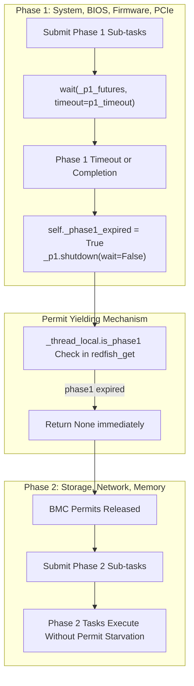
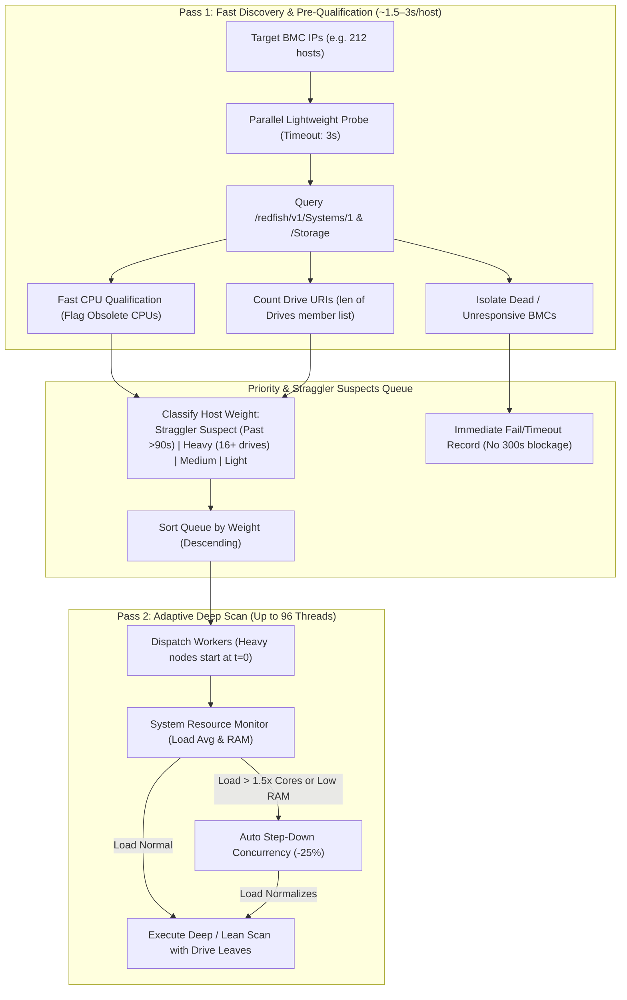
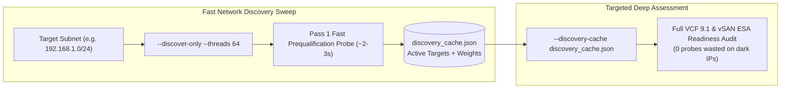

# Redfish Collector Architecture & Scanning Optimizations Reference

> Architectural reference guide for AI code reviewers, engineering contributors, and maintainers working on `vcf_hci.collector`.
> Documents concurrency models, phase task isolation, adaptive throttling, caching mechanics, and OEM-specific hardware quirks.

---

## 1. System Overview & Two-Tier Concurrency Model

The Redfish collection engine employs a **two-tier concurrency model** designed to maximize fleet scanning throughput while protecting fragile enterprise BMC web servers (iDRAC, iLO, XCC, CIMC) from HTTP request exhaustion.

```
┌─────────────────────────────────────────────────────────────────────────────┐
│ Tier 1: Outer fleet dispatch (vcf_hci/scan.py scan_hosts)                   │
│ --threads default 8, CLI maximum 96. In-flight hosts follow that limit.     │
└───────────────┬─────────────────────────────────────────────┬───────────────┘
                │ Host 1 (192.168.1.10)                       │ Host 2 (192.168.1.11)
                ▼                                             ▼
┌───────────────────────────────────────────────┐ ┌───────────────────────────┐
│ Tier 2: Adaptive Condition Variable Concurrency│ │ Tier 2: Adaptive          │
│ self._max_inner_workers = 2..5 (Adaptive)     │ │ Condition Variable        │
│ self._conn_pool.max_connections = 2..5 (1:1)  │ │ Concurrency & Pool        │
│ self._inner_cv = Condition(self._cache_lock)  │ │ self._inner_cv            │
│ self._active_inner_workers: 0..N              │ │ self._active_inner_workers│
└───────────────────────────────────────────────┘ └───────────────────────────┘
```

### Key Concurrency Parameters
* **Outer Fleet Pool:** `scan_hosts()` dispatches host scans through a `ThreadPoolExecutor`. `--threads` defaults to 8 and the CLI accepts at most 96. The pool is created with `max_workers=max(effective_threads, 96)`, and the number of in-flight hosts is `effective_threads` unless `SystemThrottleMonitor` steps it down. When requested threads are above 8 and `--force-threads` is not set, `probe_fleet_network_latency()` treats average RTT above 80 ms or maximum RTT above 150 ms as high latency and clamps the dispatch limit to 8.
* **Adaptive Inner BMC Condition Variable Concurrency:** Each `BaseRedfishCollector` instance maintains an inner concurrency controller backed by a `threading.Condition` variable (`self._inner_cv`) using `self._cache_lock` (`threading.RLock`). `determine_inner_worker_ceiling()` sets `self._max_inner_workers` to 2, 3, 4, or 5. The initial value before that call is `_BMC_INNER_WORKERS` (3). Adaptive throttling clamps the active ceiling to 1.
* **Active Worker Tracking:** `self._active_inner_workers` tracks concurrent HTTP requests in flight (0 to `self._max_inner_workers`).
* **Zero Permit Leaks:** Unlike `BoundedSemaphore` with background drain threads, the Condition Variable pattern never leaks permits or leaves threads blocked across phase switches.
* **Persistent Connection Pooling & 1:1 Socket Alignment:** Each collector operates an internal `StdlibHTTPConnectionPool` managing reusable `http.client.HTTPSConnection` instances with HTTP/1.1 Keep-Alive. Crucially, `self._conn_pool.max_connections` is dynamically aligned 1:1 with `self._max_inner_workers`, guaranteeing dedicated persistent sockets without pool contention.
* **Dynamic Inter-Request Pacing:**
  * **Pipelined Zero-Pacing (`0.0s`):** When `MultipleHTTPRequests: true` is advertised (HPE Gen12 iLO 7, Lenovo ThinkSystem V3/V4) and the collector is unthrottled, pacing delay is reduced to 0.0s, eliminating 5–10s of artificial idle time per scan.
  * **Conservative pacing floor (`>=0.10s`):** `compute_request_pacing()` applies it while `_throttled` is true, and also when `vendor` is `cisco` or `supermicro` and `multiple_http_requests` is false.
  * **Default pacing (`0.05s`):** `_request_pacing_s` is `0.05` when ServiceRoot does not advertise `MultipleHTTPRequests`, and `compute_request_pacing()` returns that base value for other unthrottled vendors.

---

## 2. Phase Execution & Task Starvation Guardrails

Host scanning runs in two distinct, timed execution phases. `_phase_wait_budgets()` derives both waits from `--host-timeout` (default 300 seconds), not from a fixed 60-second cap:

```python
# BaseRedfishCollector._phase_wait_budgets()
ht = float(getattr(self, "host_timeout", 300) or 300)
if ht < 60.0:
    ht = 60.0
remaining = max(60.0, ht - float(elapsed_s or 0) - 15.0)
raw_p1 = min(180.0, max(60.0, ht * 0.4))
raw_p2 = min(300.0, max(90.0, ht * 0.6))
if raw_p1 + raw_p2 <= remaining:
    return raw_p1, raw_p2
scale = remaining / (raw_p1 + raw_p2)
p1 = max(30.0, raw_p1 * scale)
p2 = max(60.0, remaining - p1)
return p1, p2
```

* **Phase 1:** Basic system summary, BIOS attributes, SEL event log, OS software inventory, BMC security/license, PCIe device tree, and Firmware Inventory. `wait(_p1_futures, timeout=p1_timeout)` uses the Phase 1 budget above.
* **Phase 2:** Subsystem collectors (Storage controllers/drives, Network adapters, Memory DIMMs, GPU accelerators, FC HBAs, Power/PSUs, Thermal/Telemetry), bounded by the Phase 2 budget.



### The Permit Starvation Problem & Fix
* **Problem:** If Phase 1 reached its `_phase_wait_budgets()` timeout (BMC latency or a long `FirmwareInventory` sweep), background threads from Phase 1 remained active in Python's thread pool and continued making `_get()` calls. Under adaptive throttling (1 worker permit), these lingering Phase 1 threads monopolized the single BMC permit, completely blocking Phase 2 tasks (`storage`, `network`, `memory`) until Phase 2 also timed out.
* **Fix (Phase Isolation & Nested Pool Throttling):**
  1. Phase 1 threads are tagged via thread-local state: `_thread_local.is_phase1 = True`.
  2. Nested worker pools (NIC ports, NDFs, storage drives, DIMMs, PCIe devices) wrap their tasks via `_wrap_phase_task()` so worker threads inherit `is_phase1` / `is_phase2`.
  3. When already running inside a phase worker, nested pools cap `max_workers` at 1 (`_get_phase_worker_count()`) to eliminate thread amplification beyond `_BMC_INNER_WORKERS`.
  4. When Phase 1 completes or reaches its timeout, `self._phase1_expired = True` is set and active inner workers are drained via `self._inner_cv.wait_for(..., timeout=3.0)` before entering Phase 2.
  5. Inside `_get()`, any request originating from a thread where `_thread_local.is_phase1` is True and `self._phase1_expired` is True returns `None` immediately.
  6. This guarantees that Phase 1 background tasks instantly yield BMC permits to Phase 2 tasks upon phase transition.

---

## 3. Adaptive Throttling Mechanics

Enterprise BMC controllers often degrade or drop TLS handshakes when under sustained query load. Adaptive throttling monitors consecutive timeouts and dynamically scales inner concurrency using a Condition Variable without permit leakage.

```
                  ┌───────────────────────────────────────────────┐
                  │ Base State: 2..5 Active BMC Workers (Adaptive)│
                  │ max_allowed = self._base_max_inner_workers    │
                  │ max_connections = self._base_max_inner_workers│
                  └───────────────────────┬───────────────────────┘
                                          │
            HTTP 429/503 or               │     4 Consecutive 200 OKs
            2 Consecutive Timeouts        │     (Successful HTTP GETs)
                                          ▼
                  ┌───────────────────────────────────────────────┐
                  │ Throttled State: 1 Active BMC Worker          │
                  │ max_allowed = 1 (self._throttled=True)        │
                  │ max_connections = 1 (Socket pool aligned)    │
                  │ pacing = max(pacing, 0.10s)                   │
                  └───────────────────────────────────────────────┘
```

### Implementation Highlights (`vcf_hci/collector/base.py`)
* **Circuit Breaker Step-Down (`_handle_429_or_503` & `_handle_timeout`):** When HTTP 429/503 is received or `_consecutive_timeouts >= 2`, `self._throttled = True` is engaged. Concurrency is instantly demoted (`self._max_inner_workers = 1`), `self._conn_pool.max_connections` is clamped to 1, and inter-request pacing escalates with exponential backoff (up to 2.0s ceiling).
* **Step-Up Recovery:** When `_consecutive_successes >= 4` while throttled, `self._throttled = False` is restored, `self._max_inner_workers = self._base_max_inner_workers` is restored, `self._conn_pool.max_connections` is re-aligned to the base worker count, and `self._inner_cv.notify_all()` unblocks waiting threads.
* **Phase Transition Guarantee:** At Phase 2 entry, when the BMC is still responsive, `self._throttled = False` and `self._inner_cv.notify_all()` run. Pipelined targets also set `_request_pacing_s = 0.0`. That block does not assign `_max_inner_workers` back to `_base_max_inner_workers`; the base ceiling returns only after `_consecutive_successes >= 4` in `_check_adaptive_throttle()`. Phase 1 requests stop separately because `_phase1_expired` makes `redfish_get()` return `None`.
* **SSL Handshake Backoff:** When an `SSLError` or `URLError` containing `"handshake"` or `"ssl"` occurs during retry, `time.sleep(2)` is applied before retrying to allow the BMC TLS stack to recover.

---

## 4. OEM Hardware Quirks & Optimization Catalog

### Dell iDRAC
* **FirmwareInventory Duplicate URIs:** Dell iDRAC lists duplicate `Installed-*` items alongside `Current-*` items for every hardware component (e.g. `Current-159-2.21.1__BIOS.Setup.1-1` vs `Installed-159-2.21.1__BIOS.Setup.1-1`).
  * **Optimization (`collect_system.py`):** `collect_firmware_inventory()` filters out `Installed-*` URIs when a matching `Current-*` URI exists for the same component suffix. This reduces firmware GET calls from 50+ down to ~20 with zero loss of physical hardware data.
* **Firmware Priority Sorting:** Remaining firmware URIs are sorted by priority: System/BIOS/iDRAC/CPLD/NIC/Storage Controller URIs (priority 0) are fetched before disk drive firmware URIs (priority 2).
* **PCIe Device Tree Capping:** Dell servers with large expansion backplanes expose 60+ PCIe device URIs under `/Chassis/System.Embedded.1/PCIeDevices`.
  * **Optimization (`collect_gpu.py`):** PCIe member URIs are priority-sorted using `_uri_priority_key()` (slots, integrated NICs, RAID, OCP, GPUs given priority 0; bridges and root ports given priority 2) and capped at **64 items max**, processed in time-bounded chunks with a 15-second total phase cap. A hit on the cap or the deadline sets `pcie_inventory_partial` so the report does not present the table as complete.
* **OData expand (`oem/dell.py` `oem_expandable_collections()`):** Models containing `R630`, `R730`, `R930`, `T630`, or `13G` return an empty map. Other Dell targets map FirmwareInventory, `{sys_uri}/EthernetInterfaces`, chassis `ThermalSubsystem/Fans`, `{sys_uri}/Memory`, and `{mgr_uri}/Oem/Dell/Jobs`.
* **Nuvoton Arbel High Concurrency (17G / iDRAC10):**
  * `classify_bmc_silicon()` returns `"Nuvoton Arbel"` for `arbel`, `idrac10` / `idrac 10`, `remote access controller 10`, models `r670`, `r770`, `r7725`, `r870`, `r970`, `c670`, `poweredge 17g`, or Dell iDRAC firmware that starts with `10.`. `determine_inner_worker_ceiling()` returns **5** only when `multiple_http_requests` is true and `"arbel"` is in that silicon string. Otherwise this silicon string takes the non-pipelined path and returns **3** (`"nuvoton arbel"` does not match the Pilot/AST high-latency rule).

### HPE iLO (iLO 4 / iLO 5 / iLO 6 / iLO 7)
* **Embedded LOM Discovery:** HPE iLO 5 exposes physical ALOM cards under `/Chassis/1/NetworkAdapters`, but exposes onboard 1GbE/10GbE LOMs (e.g. HPE 331i 4-port) under `/Systems/1/BaseNetworkAdapters` and `/Systems/1/EthernetInterfaces`.
  * **Optimization (`collect_network.py`):** `f"{self.sys_uri}/BaseNetworkAdapters"` is explicitly included in network endpoints to discover onboard LOMs with full branding, manufacturer (`Hewlett Packard Enterprise`), and part numbers.
* **Sequential Network Device Functions (NDF) Early Break:** In `pci_utils.extract_pci_ids_from_dict()`, querying all 16 `NetworkDeviceFunctions` sequentially per adapter adds ~8s per adapter.
  * **Optimization (`pci_utils.py`):** The loop breaks early as soon as the first function returns valid `VendorId` and `DeviceId`.
* **Transient 503 / Resource Not Ready:** HPE iLO 5 returns `Oem.Hpe.ResourceNotReadyRetry` during background inventory refresh.
  * **Optimization (`oem/hpe.py`):** `oem_handle_retry()` detects this condition, pauses for 3 seconds, and retries the HTTP GET once.
* **iLO expand (`oem/hpe.py` `oem_expandable_collections()`):** Memory, Chassis Thermal, ThermalSubsystem Fans, and FirmwareInventory are level 1. When `expand_max_levels >= 2` or `expand_syntax == "*"`, Chassis NetworkAdapters is added at level 2 and Storage at level 1.
* **iLO 7 pipelined pacing and concurrency (Gen12):**
  * `classify_bmc_silicon()` returns `"HPE Gen12 Custom 64-bit"` when the search text contains `ilo 7`, `ilo7`, or `gen12`. Zero pacing is `compute_request_pacing()` returning `0.0` when `multiple_http_requests` is true and the collector is not throttled; silicon alone does not force it. `determine_inner_worker_ceiling()` returns **5** when that flag is true and the silicon string contains `ilo 7` or `gen12`. The same silicon string otherwise returns **3**.

### Lenovo ThinkSystem (XCC / XCC2 / XCC3)
* **Expand map (`oem/lenovo.py` `oem_expandable_collections()`):** FirmwareInventory, `{sys_uri}/Memory`, and `{chassis_uri}/PCIeDevices`, plus Chassis NetworkAdapters at level 2.
* **Pipelined zero-pacing:** `_request_pacing_s` is `0.0` only when ServiceRoot `ProtocolFeaturesSupported.MultipleHTTPRequests` is true. `compute_request_pacing()` keeps that `0.0` while the collector is unthrottled.
* **AST2600 concurrency:** `classify_bmc_silicon()` returns `"AST2600"` for `ast2600`, `sr650 v3`, `sr630 v3`, `sr650 v4`, `sr630 v4`, `sr675 v3`, `vx650 v3`, `xcc2`, `xcc3`, `x13`, `x14`, `h13`, `h14`, `c220 m6`, `c240 m6`, `c220 m7`, or `c240 m7`. `determine_inner_worker_ceiling()` returns **4** only when `multiple_http_requests` is true and `"ast2600"` is in the silicon string. Without that flag the same silicon returns **3**, or **2** when `initial_latency_ms >= 350` because `"ast"` matches the high-latency rule. The c=5 inflection at 366 ms is the existing recorded saturation observation, not a second ceiling.

### Supermicro BMC
* **HTML 404 Non-JSON Responses:** Supermicro Lighttpd web servers return HTML 404 pages instead of Redfish JSON error bodies when an endpoint is missing.
  * **Guardrail (`base.py`):** All HTTP response parsing is wrapped in `try ... except json.JSONDecodeError` to prevent crashes.
* **DCMS License Gating:** `/Storage` endpoints on Supermicro BMCs return `OemLicenseNotPassed` unless a DCMS license key is installed.
  * **Optimization (`oem/supermicro.py`):** `_is_license_blocked()` detects license gates and transparently falls back to `/Systems/1/SimpleStorage`.
* **Expand hook:** `oem_expandable_collections()` returns `{}`.
* **Conservative pacing and legacy ceiling:** `compute_request_pacing()` applies `max(pacing, 0.10)` when `vendor == "supermicro"` and `multiple_http_requests` is false. `classify_bmc_silicon()` returns `"AST2400"` for `ast2400`, or for `x10` when the text also contains `supermicro` or `smc`. `determine_inner_worker_ceiling()` returns **2** for that silicon only on the non-pipelined path. A pipelined AST2400 target uses the pipelined branch instead (4 when `0 < initial_latency_ms < 350`, otherwise 3).

### Cisco IMC
* **Manager Path Discrepancy:** Cisco IMC uses `/Managers/CIMC` rather than standard `/Managers/1` or `/Managers/iDRAC.Embedded.1`.
  * **Optimization (`oem/cisco.py`):** `oem_manager_paths()` registers `/Managers/CIMC`.
* **Chassis-Level SEL:** LogServices are exposed under `/Chassis/1/LogServices/SEL` rather than the system root.
* **Expand hook (`oem/cisco.py` `oem_expandable_collections()`):** Returns `{}` when `expand_supported` is false. Otherwise it maps Chassis NetworkAdapters at level 2, and Memory, Storage, and `{sys_uri}/EthernetInterfaces` at level 1. A previous revision of this guide recorded at least a 40% drop in network-phase GET calls with field parity; that figure is historical and was not remeasured.
* **Generational concurrency:** `classify_bmc_silicon()` returns `"Pilot-3"` for `c220 m4` / `c240 m4`, `"AST2500"` for `c220 m5` / `c240 m5`, and `"AST2600"` for `c220 m6`, `c240 m6`, `c220 m7`, and `c240 m7`. The ceiling is `determine_inner_worker_ceiling()`, not a separate Cisco table: non-pipelined Pilot-3 returns 2; non-pipelined AST2500 returns 3, or 2 when `initial_latency_ms >= 350`; pipelined AST2600 returns 4. `compute_request_pacing()` applies the 0.10s floor when `vendor == "cisco"` and `multiple_http_requests` is false.

### Quanta BMC
* **Fast-Path Self Roots:** Quanta BMCs (e.g. QuantaGrid D42A-2U) place system, chassis, and manager roots under `/Systems/Self`, `/Chassis/Self`, and `/Managers/Self`.
  * **Optimization (`oem/quanta.py`):** `oem_fastpath_roots()` probes `/Systems/Self` first, avoiding slow collection member iteration.
* **Storage Endpoint Dedup:** Redfish storage mixin probes `/Storage` automatically.
  * **Optimization (`oem/quanta.py`):** `oem_storage_endpoints()` returns `{sys_uri}/SimpleStorage` when `sys_uri` is set. `oem_expandable_collections()` returns `{}`, and the adapter sets `expand_supported = False`.
* **Shallow Crawl Tolerance:** Ingested Quanta mockups omit deep Processor and Storage leaves. The collector gracefully falls back to ProcessorSummary and SimpleStorage without failing the scan.

### GIGABYTE BMC (AMI MegaRAC)
* **Fast-Path Self Roots:** AMI MegaRAC firmware identifies system, chassis, and manager entities under `/Self`.
  * **Optimization (`oem/gigabyte.py`):** `oem_fastpath_roots()` probes `/Systems/Self` first, immediately resolving root URIs.
* **Drive Telemetry Mapping:** Drives expose slot numbers under `Oem.GBT.SlotNumber`.
  * **Optimization (`oem/gigabyte.py`):** `oem_drive_metrics()` reads `Oem.GBT`, `Oem.Gbt`, or `Oem.Gigabyte`, and copies `SlotNumber` when present.
* **Expand hook:** `oem_expandable_collections()` maps `{sys_uri}/Storage` and `{sys_uri}/Memory` at level 1, and also registers `/redfish/v1/Systems/Self` and `/redfish/v1/Systems/1` for both collections.

### ASRock Rack BMC (AMI MegaRAC)
* **Registry:** `ASRockCollector` is the last `_REGISTRY` entry. `VENDOR_MATCH` includes `ASROCK`, `ASROCKRACK`, `ASROCK RACK`, `ROMED8`, `EPYCD8`, `GENOAD8`, and `BERGAMOD8`.
* **Fast-path and managers:** `oem_fastpath_roots()` probes `/redfish/v1/Systems/Self` and, on success, returns Systems/Chassis/Managers `Self`. `oem_manager_paths()` returns `/redfish/v1/Managers/Self` and `/redfish/v1/Managers/1`.
* **Expand hook (`oem_expandable_collections()`):** Storage and Memory at level 1 for the active `sys_uri`, plus the same two collections under `/redfish/v1/Systems/Self` and `/redfish/v1/Systems/1`. The constructor sets `expand_syntax = "*"`, `expand_max_levels = 2`, and `expand_supported = True`. `classify_bmc_silicon()` has no ASRock era; an empty silicon string uses the fallback in `determine_inner_worker_ceiling()`.

---

## 4.1 Silicon Architecture Classification & Inner Worker Sizing Matrix

To safely optimize fleet collection throughput without risking watchdog resets or socket exhaustion on older BMCs, `vcf_hci.collector.discovery` automatically classifies the target BMC controller's silicon generation and configures inner worker concurrency and Keep-Alive connection pool capacity accordingly.

### Classification & Sizing Rules (`vcf_hci/collector/discovery.py`)

`classify_bmc_silicon()` checks the eras below in order and returns `""` when none match. `_configure_inner_worker_sizing()` passes that string, `multiple_http_requests`, the initial GET latency, and the root `Model` into `determine_inner_worker_ceiling()`. The connection pool is then set 1:1 with the returned ceiling.

```python
# determine_inner_worker_ceiling() in vcf_hci/collector/discovery.py
silicon_lower = (silicon_generation or "").strip().lower()
model_lower = (model or "").lower()

if multiple_http_requests:
    if "arbel" in silicon_lower or "ilo 7" in silicon_lower or "gen12" in silicon_lower:
        return 5
    if "ast2600" in silicon_lower:
        return 4
    if 0 < initial_latency_ms < 350.0:
        return 4
    return 3

if "pilot-3" in silicon_lower or "pilot3" in silicon_lower or "ast2400" in silicon_lower:
    return 2
if any(m in model_lower for m in ("r7525", "r6525", "r7515", "r7415", "r7425", "r6415", "r6515")):
    return 2
if initial_latency_ms >= 350.0 and ("pilot" in silicon_lower or not silicon_lower or "ast" in silicon_lower):
    return 2
return 3
```

`compute_request_pacing()` returns `0.0` when `multiple_http_requests` is true and the collector is not throttled. It returns at least `0.10` while throttled, and also for `vendor` `cisco` or `supermicro` when pipelining is off. Silicon generation does not itself select the pacing value. Recorded saturation figures below are historical observations, not additional return values.

| Silicon Era | `classify_bmc_silicon()` match, in order | Ceiling from `determine_inner_worker_ceiling()` | Recorded saturation (historical) |
| :--- | :--- | :--- | :--- |
| **Nuvoton Arbel** | `arbel`, `idrac10`, `idrac 10`, `remote access controller 10`; or `r670`, `r770`, `r7725`, `r870`, `r970`, `c670`, `poweredge 17g`; or Dell plus iDRAC and firmware starting `10.` | **5** when `multiple_http_requests` and `"arbel"` is in the silicon string; otherwise **3** | Flat across c=1..5 |
| **HPE Gen12 Custom 64-bit** | `ilo 7`, `ilo7`, `gen12` | **5** when `multiple_http_requests` and the silicon string contains `ilo 7` or `gen12`; otherwise **3** | Relative inflection at c=3 (absolute under 103 ms) |
| **AST2600** | `ast2600`; `sr650 v3`, `sr630 v3`, `sr650 v4`, `sr630 v4`, `sr675 v3`, `vx650 v3`, `xcc2`, `xcc3`; `x13`, `x14`, `h13`, `h14`; `c220 m6`, `c240 m6`, `c220 m7`, `c240 m7` | **4** when `multiple_http_requests`; otherwise **3**, or **2** when latency is at least 350 ms | c=5 at 366 ms, 2.9x baseline |
| **Pilot-3** | `pilot-3`, `pilot3`; `r730xd`, `r730`, `r630`, `r930`, `idrac8`, `idrac 8`, `remote access controller 8`; `c220 m4`, `c240 m4`, `gen9`, `ilo 4`, `ilo4` | Non-pipelined: **2**. Pipelined: **4** when `0 < latency < 350`, else **3** | c=3 at 2,111 ms, 4.4x surge |
| **AST2400** | `ast2400`; or `x10` together with `supermicro` or `smc` | Same non-pipelined **2** / pipelined **4-or-3** split as Pilot-3 | Grouped with the Pilot-3 observation above |
| **AST2500** (also `pilot-4` / `pilot4`) | `ast2500`, `pilot-4`, `pilot4`; `r740`, `r640`, `r750`, `r650`, `r760`, `r660`, `r7525`, `r6525`, `r7515`, `r7415`, `r7425`, `r7615`, `r7625`, `r6415`, `r6515`, `r840`, `r940`, `r960`; `idrac9`, `idrac 9`, `remote access controller 9`; `c220 m5`, `c240 m5`; bare `sr650` / `sr630`; `gen10`, `gen11`, `ilo 5`, `ilo 6`; `x11`, `x12`; `quanta`, `d42a` | Pipelined: **4** when `0 < latency < 350`, else **3**. Non-pipelined: **2** when the model contains `r7525`, `r6525`, `r7515`, `r7415`, `r7425`, `r6415`, or `r6515`; otherwise **2** at latency of at least 350 ms, else **3** | c=5 at 295 ms, 3.1x baseline |
| **Unclassified** | return `""` | Pipelined: **4** when `0 < latency < 350`, else **3**. Non-pipelined: **2** at latency of at least 350 ms, else **3**, unless the Dell AMD model rule above matches | — |

---

## 5. Caching Mechanics

`BaseRedfishCollector` maintains two distinct, thread-safe in-memory cache structures per host scan:

```
┌─────────────────────────────────────────────────────────────────────────────┐
│ Positive Request Cache: self._request_cache                                 │
│ Maps exact URL -> parsed JSON dict                                          │
│ Bypasses network GET for duplicate references (e.g., Managers, UpdateService)│
└─────────────────────────────────────────────────────────────────────────────┘

┌─────────────────────────────────────────────────────────────────────────────┐
│ Negative Endpoint Cache: self._negative_endpoints                           │
│ Stores path suffixes that returned HTTP 404 (e.g., /LogServices)            │
│ Fast-bypasses subsequent calls to known non-existent paths on this host     │
└─────────────────────────────────────────────────────────────────────────────┘
```

---

## 6. Tiered Scan Depth Profiles & Trade-off Matrix

| Profile / Setting | Scope & Collection Depth | Duration | Use Case & Guidance |
| :--- | :--- | :--- | :--- |
| **`readiness-full`** (Default) | Exhaustive audit: Phase 1 (BIOS, SEL, Firmware Inventory, PCIe, Licenses) + Phase 2 (Storage, NICs, Memory, DIMM topology, GPUs, HBAs, LLDP, Telemetry). | ~25–60s / host | **Standard for VCF 9.1 Readiness**: produces complete hardware audit and vSAN ESA certification. |
| **`readiness-lean`** (`--lean` / `--profile readiness-lean`) | High-speed audit: Phase 1 + Phase 2 core storage/NICs/memory, skipping historical telemetry logs, secondary member GETs, and extra sensor walks. | ~15–30s / host | **High-Throughput Fleet Audits**: ideal for large enterprise sweeps where vSAN ESA readiness verdict is required without historical metrics. |
| **`inventory-lite`** (`--profile inventory-lite`) | Rapid pre-screening: Systems summary, CPU verdict, Power/Thermal rollup, Storage controller rollup, NIC summary (no deep DIMM/PCIe/FW walk). | Shortest supported profile | **Rapid Pre-Qualification**: filters platforms before a full readiness scan. |
| **LAN concurrency** (`--threads`, default 8, maximum 96) | Outer in-flight hosts follow the requested thread count. Inner workers follow `determine_inner_worker_ceiling()`, not a fixed 3. | High throughput | Operator-selected for a dedicated management subnet. The latency clamp does not raise the thread count. |
| **VPN / WAN auto-throttle** | When requested threads are above 8 and `--force-threads` is absent, average RTT above 80 ms or maximum RTT above 150 ms clamps dispatch to 8. | Medium | Prevents connection drops and TCP socket exhaustion over WAN/VPN links. |
| **Allow Partial Scans** (`--allow-partial`) | Harvests valid subsystems even if non-critical endpoints time out. | Resilient | **Always recommended** for large fleets with mixed or degraded BMC health. |

---

## 7. Troubleshooting Slow, Unresponsive, and Partial BMC Scans

Enterprise BMCs are embedded microcontrollers running resource-constrained Real-Time Operating Systems (RTOS) or stripped-down embedded Linux kernels (e.g. Dell iDRAC Linux, HPE iLO ASIC, Supermicro Lighttpd/ATEN). Under heavy polling, background firmware updates, or high fleet concurrency, BMCs can become sluggish or unresponsive.

### 7.1 Diagnostic Symptoms & Root Causes

| Symptom / Log Output | Underlying Root Cause | Impact |
| :--- | :--- | :--- |
| `[⚠️] <host> (Partial Scan (missing: ...))` | Redfish collection reached the Phase 1 or Phase 2 wait from `_phase_wait_budgets()` (`--host-timeout`, default 300s). Specific sub-tasks (storage, NICs, firmware) were cut off. | Individual host report is marked with `⚠️ Partial (Incomplete)` banner; hardware tables missing data display warning callouts. |
| `[WARN] <host> — BMC latency/timeout detected (2 consecutive timeouts) — stepping down concurrency` | The BMC embedded web server is overwhelmed or dropping connections. The collector dynamically throttles to 1 inner worker. | Scan slows down for this host to avoid tripping BMC DoS protections. |
| `[SECTION ERROR] <host> / firmware_inventory: timed out` | Dell iDRAC or HPE iLO firmware inventory did not finish inside the Phase 1 wait. | BIOS and System summary succeed; firmware table reports missing data. |
| `[SECTION ERROR] <host> / storage: timed out` | A controller or drive query under storage did not finish inside the Phase 2 wait. | Storage disks and controllers missing from report. |
| `URLError / SSLError: [SSL: BAD_HANDSHAKE_LENGTH]` or Connection reset | BMC TLS session cache exhaustion. The BMC cannot negotiate new SSL handshakes. | Collector applies 2s exponential backoff and retries. |

### 7.2 Remediation Playbook

#### Action 1: Soft-Reset the BMC Controller
A soft-reset restarts the BMC out-of-band processor (iDRAC, iLO, CIMC) without impacting the running host OS, production VMs, or data path.

* **Dell PowerEdge (iDRAC 7/8/9):**
  ```bash
  # Remote via racadm (from admin workstation):
  racadm -r <bmc_ip> -u <user> -p <pass> racreset

  # Or via SSH into iDRAC:
  ssh <user>@<bmc_ip> "racreset"
  ```
  *Wait 2–3 minutes for iDRAC web interface to finish booting before re-scanning.*

* **HPE ProLiant (iLO 4/5/6):**
  ```bash
  # Remote via SSH into iLO:
  ssh <user>@<bmc_ip> "iloreset"

  # Or via hponcfg (from ESXi/Linux host OS):
  hponcfg -r
  ```
  *Wait 90–120 seconds for iLO services to restart.*

* **Supermicro / Intel / Generic IPMI:**
  ```bash
  # Cold reset of BMC management controller:
  ipmitool -I lanplus -H <bmc_ip> -U <user> -P <pass> mc reset cold
  ```
  *Wait ~2 minutes for IPMI/Redfish stack to reinitialize.*

* **Cisco UCS (IMC):**
  ```bash
  # Via SSH into CIMC:
  ssh <user>@<bmc_ip> "scope chassis; scope bmc; reboot"
  ```

#### Action 2: Use the "Retry Incomplete Hosts" Web UI Feature
The Web UI provides a dedicated **"🔄 Retry Incomplete Hosts"** remediation button in the Post-Scan Summary card whenever failed or partial hosts occur:
1. Automatically extracts only the failed and partial scan IP addresses.
2. Applies the **Gentle Retry Profile**:
   * Clamps concurrency threads to **4** (or **2** for small batches) to eliminate network and BMC socket pressure.
   * Extends per-host scan timeout to **10 minutes (600s)**.
   * Ensures **Allow Partial Scans** is enabled.
3. Automatically populates the target range and focuses the Discovery card for immediate re-execution.

#### Action 3: Pre-Scan Latency Probing & VPN Auto-Throttling (v7.0.0+)
The scanner automatically performs a TCP RTT latency probe on candidate target BMCs before scanning begins (`probe_fleet_network_latency()` in `vcf_hci.protocol`):
* If average RTT is above 80 ms or maximum RTT is above 150 ms, and the requested thread count is above 8, concurrency is clamped to **8 threads** unless `--force-threads` is set.
* If unconstrained thread concurrency is explicitly required across a VPN, pass `--force-threads` on the CLI or `force_threads: True` in the Web API.

#### Action 4: CLI Fleet Tuning Options for Slow BMC Networks
When running from the command line on fleets with known sluggish BMCs or high-latency VPN links:
```bash
# Recommended gentle scan profile:
export REDFISH_PASSWORD='replace-me'
python vcfr_collector.py \
  --targets 192.0.2.10,192.0.2.20 \
  --username readonly \
  --password-env REDFISH_PASSWORD \
  --threads 4 \
  --host-timeout 600 \
  --allow-partial \
  --output-dir ./scan_results
```
* Use `--two-pass` to run Pass 1 fast discovery and schedule storage-heavy nodes first via Longest-Job-First (LJF).
* Use `--lean` or `--profile readiness-lean` when the supported faster readiness profile is enough.
* Use `--profile inventory-lite` for the rapid hardware pre-screen.
* Use `--force-threads` to override automatic VPN latency thread-capping.

---

## 7. Two-Pass Discovery & Longest-Job-First (LJF) Priority Scheduling

Large enterprise fleets often feature a heterogeneous mix of lightweight compute nodes (2 drives, ~15s scan time) and storage-dense vSAN nodes (24+ drives, ~180–240s scan time). Standard FIFO dispatch causes the **"Straggler Effect"**, where 24-drive nodes dispatched late in the run force 95 threads to idle while waiting for the tail to finish.



### Key Mechanics
1. **Pass 1 Lightweight Discovery (`vcf_hci/fleet_discovery.py`):**
   * Issues 2 minimal Redfish GET requests: `/redfish/v1/Systems/1` and `/redfish/v1/Systems/1/Storage`.
   * Fast timeout of 3.0s per request to avoid blocking on unresponsive BMCs.
   * Counts drive URI links in storage controllers without fetching drive leaves.
2. **Historical "Straggler Suspects" Cache:**
   * If a previous scan exists, hosts with past scan duration >90s are tagged as **Priority 0 (Straggler Suspect)** for instant dispatch at $t=0$.
3. **Longest-Job-First (LJF) Dispatch:**
   * All heavy 24-drive nodes are dispatched into the thread pool at $t=0$.
   * While heavy nodes perform drive leaf walks, remaining threads concurrently sweep through medium and light nodes, eliminating the straggler long-tail.

---

## 8. Dynamic System Auto-Stepdown Monitor (`vcf_hci/system_throttle.py`)

When running high concurrency (e.g. `--threads 96`), the scanner monitors host system health using standard library APIs only (`os.getloadavg()`, `os.cpu_count()`, `/proc/meminfo`):

* **Auto-Stepdown Trigger:** If 1-minute load average exceeds `1.5 * CPU cores` (e.g. load > 12 on an 8-core host) or available RAM falls below 10%, outer worker concurrency is stepped down by 25% (e.g. 96 $\rightarrow$ 72 threads).
* **Auto-Stepup Recovery:** When load average drops below `1.0 * CPU cores` and available RAM exceeds 20%, outer worker permits scale back up to the configured thread target.

---

## 9. Subnet-Wide Out-of-Band Discovery Caching & Inactive Target Pruning

In enterprise datacenters with large subnet allocations (`/24`, `/20`, or `/16`), many IP addresses are unoccupied ("dark") or assigned to non-BMC endpoints. Probing hundreds of unresponsive IPs with full multi-layer HTTP collection wastes significant time and thread permits.

Inspired by discovery caching principles from projects like OpenCHAMI Magellan, the scanner supports decoupled discovery, persistent discovery caching, and inactive target pruning:

### 9.1 Discovery Caching Architecture (`--discovery-cache`, `--discover-only`, `--prune-inactive`)



### 9.2 Key CLI Capabilities
* **Fast Network Discovery Sweep (`--discover-only`):**
  Executes only Pass 1 fast pre-qualification across candidate IP ranges or subnets, prints an ASCII status table of active BMCs with vendor, model, and weight classification, writes `data/discovery_cache.json`, and exits without launching full 5-minute deep host audits.
  ```bash
  python vcfr_collector.py --targets 192.168.1.0/24 --discover-only --threads 32
  ```
* **Persistent Discovery Caching (`--discovery-cache <file>`):**
  Loads active, reachable BMC targets directly from a prior discovery cache JSON file, skipping initial network sweeps and eliminating redundant probing across dark IPs.
  ```bash
  python vcfr_collector.py --discovery-cache ~/Desktop/VCF-Scans/discovery_cache.json --threads 16
  ```
* **Inactive Target Pruning (`--prune-inactive`):**
  When scanning subnets with Pass 1 discovery enabled, automatically filters out dark/unreachable IPs from the Phase 2 deep assessment queue, saving thread workers from timing out on closed ports.


